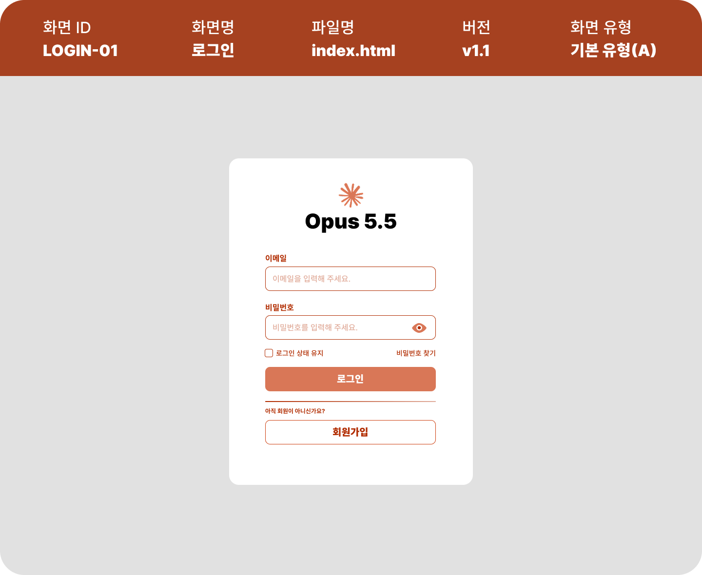
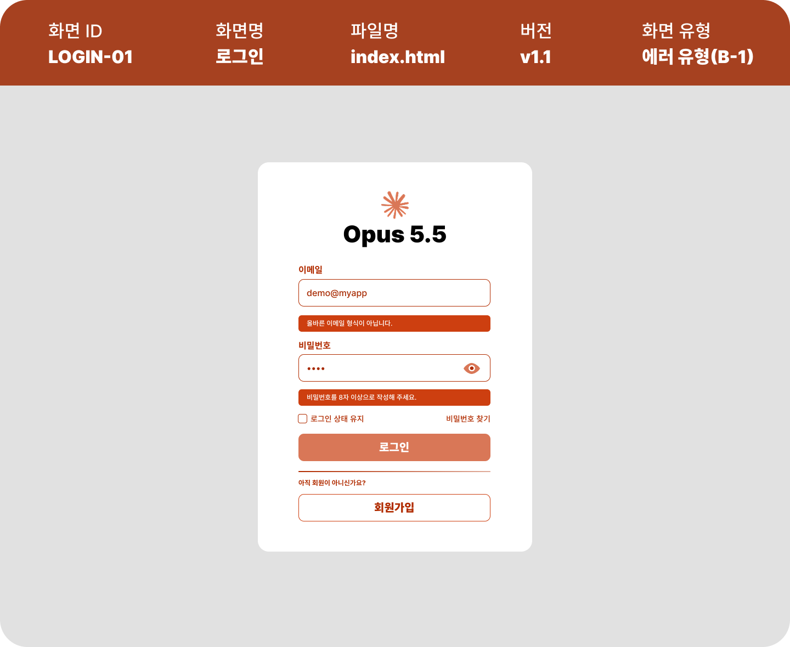
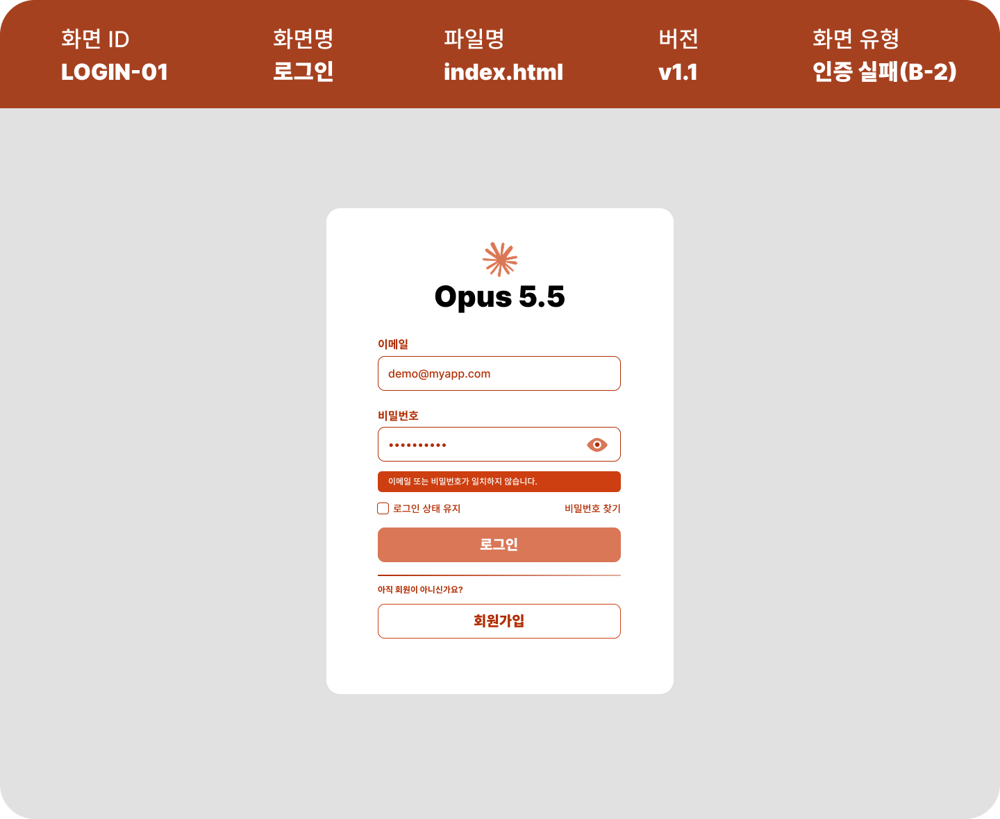
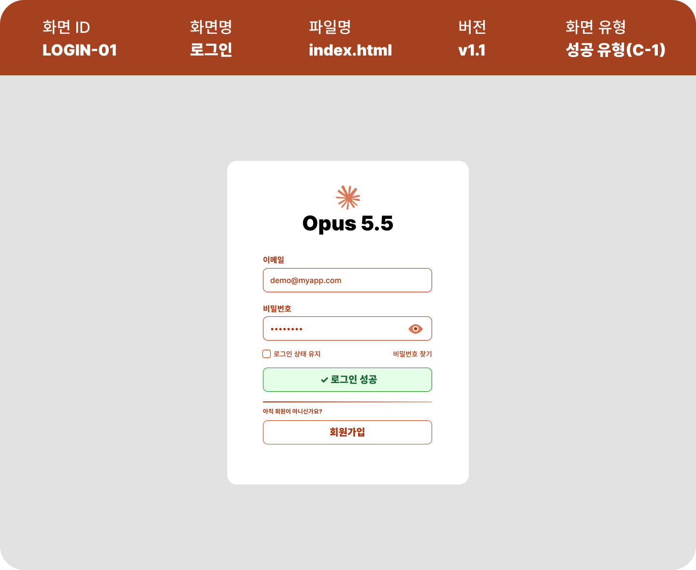
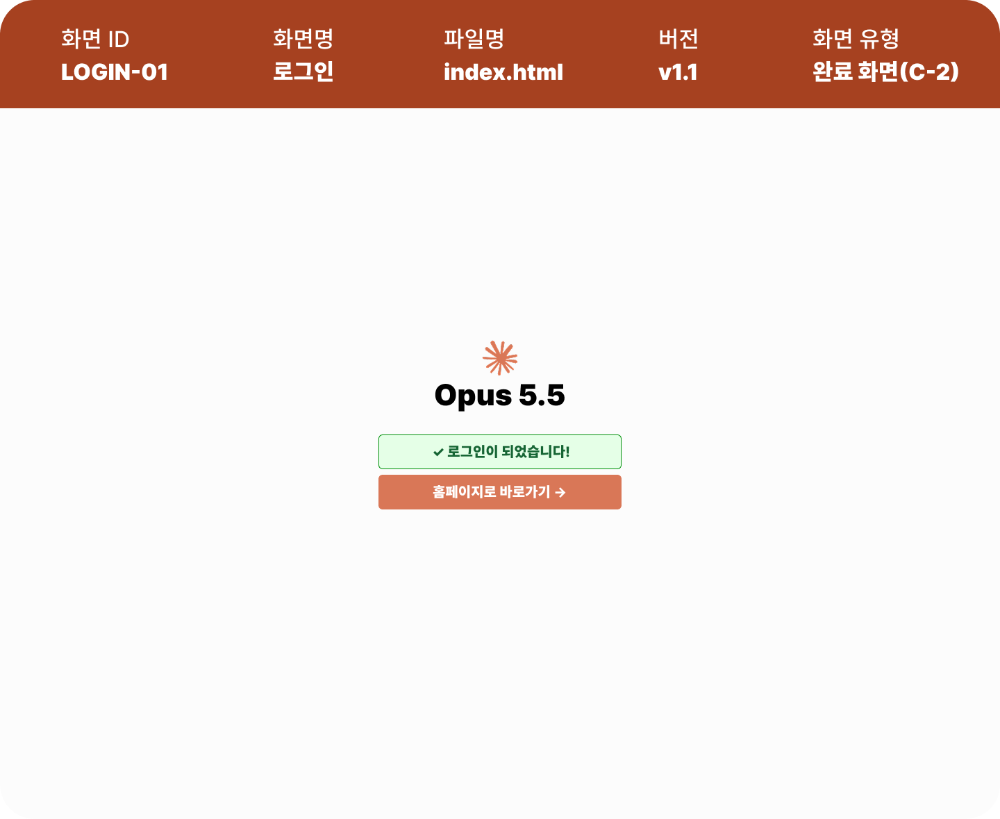
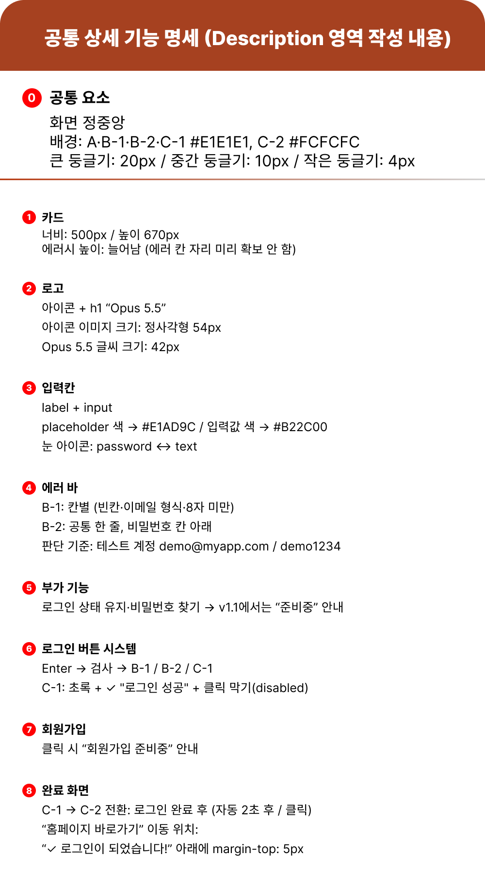

# 로그인 상태 보드 (login-page v1.1 화면 설계 기반)

---

## 화면 설계도 (login-page v1.1)

v1.1은 같은 로그인 화면을 **상태별로 나눠 그린 상태 보드(State Board)** 입니다.

| 기본 유형 (A) | 에러 유형 (B-1) | 인증 실패 (B-2) |
|:---:|:---:|:---:|
|  |  |  |

| 성공 유형 (C-1) | 완료 화면 (C-2) | 공통 상세 기능 명세 |
|:---:|:---:|:---:|
|  |  |  |

| 화면 ID | 화면명 | 파일명 | 버전 | 설계도 파일 |
|---------|--------|--------|------|-------------|
| LOGIN-01 | 로그인 | `index.html` | v1.1 | `img/login-page-v1.1.0.png` ~ `v1.1.5.png` |

---

### 테스트 계정

아래 계정으로 로그인하면 성공(C-1 → C-2)합니다. (`script.ts`의 `DEMO_ACCOUNT`에서 수정)

| 이메일 | 비밀번호 |
|--------|----------|
| `demo@myapp.com` | `demo1234` |

---

## 프로젝트 개요

v1.0의 **페이지 정중앙 카드형 로그인**을 유지하면서, 화면이 **입력 결과에 따라 어떻게 바뀌는지**를 상태별로 설계하고 구현한 버전입니다.
v1.0 설계도는 화면 한 장, v1.2 설계도는 화면 한 장 + 글로 적은 명세였다면, v1.1은 **상태마다 화면을 따로 그린 것**이 특징입니다.

---

## v1.0 → v1.1 → v1.2 달라진 점

| 구분 | v1.0 | **v1.1** | v1.2 |
|------|------|----------|------|
| 주제 | 구조 (정지 화면) | **상태 (반응하는 화면)** | 서비스화 (모달) |
| 화면 유형 | 페이지 카드 | 페이지 카드 | 레이어 팝업 |
| 설계도 | 화면 1장 | **상태 5장 + 명세 1장** | 화면 1장 + 명세 |
| 색 | 회색 | **주황 계열** + 상태색(빨강 · 초록) | 파랑 |
| 로고 | 제목 `Opus 5.5` | **아이콘 + `Opus 5.5`** | 로고 + 닫기 버튼 |
| 입력칸 | placeholder만 | **라벨 + 눈 아이콘** | 라벨 + 눈 아이콘 |
| 검사 | 빈칸 · 형식 · 8자 | **B-1 칸별 형식 검사 + B-2 계정 비교** | 정규식 + 가짜 API(로딩) |
| 에러 표시 | 빨간 글씨 | **에러 바(빨간 배경 + 흰 글씨)** | 빨간 테두리 + 글씨 |
| 성공 표시 | 토스트 | **C-1 버튼이 초록으로 → 2초 후 C-2 완료 화면** | 토스트 + 모달 닫힘 |
| 회원가입 | 버튼 | **구분선 + 안내 문구 + 테두리 버튼** | 텍스트 링크 |
| 둥글기 | 20px 하나 | **20 / 10 / 4px 3단계** | 32 / 10px |

---

## 상태 보드

| 상태 | 설계도 | 언제 | 화면 | `data-state` |
|------|--------|------|------|--------------|
| A 기본 | `v1.1.0` | 처음 열었을 때, 에러를 고쳐 다시 입력할 때 | 빈 입력칸 + placeholder | `A` |
| B-1 에러 | `v1.1.1` | 빈칸 · 이메일 형식 오류 · 비밀번호 8자 미만 | 틀린 칸 아래에 에러 바 | `B-1` |
| B-2 인증 실패 | `v1.1.2` | 형식은 통과했지만 테스트 계정과 다름 | 비밀번호 칸 아래 공통 에러 바 한 줄 | `B-2` |
| C-1 성공 | `v1.1.3` | 테스트 계정과 일치 | 로그인 버튼 → 초록 `✓ 로그인 성공` + 클릭 막힘 | `C-1` |
| C-2 완료 | `v1.1.4` | C-1에서 2초 후 자동 | 카드 사라짐, 배경 `#FCFCFC`, 완료 메시지 + 홈 버튼 | `C-2` |

### 상태 전환 흐름

```
A ──(형식 틀림)──────────────▶ B-1 ──(다시 입력, 남은 에러 없음)──▶ A
A ──(형식 통과 · 계정 불일치)──▶ B-2 ──(다시 입력)──────────────────▶ A
A ──(형식 통과 · 계정 일치)────▶ C-1 ──(자동 2초 후)───────────────▶ C-2
```

---

## 상세 기능 명세 (`v1.1.5` 기준)

### ⓪ 공통 요소

| 항목 | 명세 |
|------|------|
| 배치 | 화면 정중앙 |
| 배경 | A · B-1 · B-2 · C-1 `#E1E1E1`, C-2 `#FCFCFC` |
| 둥글기 | 큰 `20px`(카드) / 중간 `10px`(입력칸 · 버튼 · 성공 박스) / 작은 `4px`(에러 바 · 체크박스) |

### ① 카드

| 항목 | 명세 |
|------|------|
| 크기 | 너비 `500px` / 높이 `670px` (A 기준) |
| 에러 시 높이 | **늘어남** (에러 칸 자리를 미리 확보하지 않음) |

### ② 로고

| 항목 | 명세 |
|------|------|
| 구성 | 아이콘 + `h1` **Opus 5.5** |
| 아이콘 | 정사각형 `54px` |
| 글씨 | `42px` |

### ③ 입력칸

| 항목 | 명세 |
|------|------|
| 구성 | `label` + `input` |
| 색 | placeholder `#E1AD9C` / 입력값 `#B22C00` |
| 눈 아이콘 | 클릭 시 `password` ↔ `text` 전환 |

### ④ 에러 바

| 항목 | 명세 |
|------|------|
| B-1 | 칸별 — 빈칸 · 이메일 형식 · 8자 미만 |
| B-2 | 공통 한 줄, 비밀번호 칸 아래 — `이메일 또는 비밀번호가 일치하지 않습니다.` |
| 판단 기준 | 테스트 계정 `demo@myapp.com` / `demo1234` |

B-1 에러 문구:

| 칸 | 조건 | 문구 |
|----|------|------|
| 이메일 | 빈칸 | `이메일을 입력해 주세요.` |
| 이메일 | 형식 오류 | `올바른 이메일 형식이 아닙니다.` |
| 비밀번호 | 빈칸 | `비밀번호를 입력해 주세요.` |
| 비밀번호 | 8자 미만 | `비밀번호를 8자 이상으로 작성해 주세요.` |

### ⑤ 부가 기능

| 항목 | 명세 |
|------|------|
| 로그인 상태 유지 · 비밀번호 찾기 | v1.1에서는 `준비중` 안내 (토스트) |

### ⑥ 로그인 버튼 시스템

| 항목 | 명세 |
|------|------|
| 흐름 | 클릭 · Enter → 검사 → B-1 / B-2 / C-1 |
| C-1 | 초록 + `✓ 로그인 성공` + 클릭 막기(`disabled`) |

### ⑦ 회원가입

| 항목 | 명세 |
|------|------|
| 클릭 시 | `회원가입은 준비중입니다.` 안내 (토스트) |

### ⑧ 완료 화면

| 항목 | 명세 |
|------|------|
| C-1 → C-2 전환 | 로그인 완료 후 **자동 2초** |
| 간격 | `✓ 로그인이 되었습니다!` 아래 `margin-top: 5px` |
| 홈페이지로 바로가기 | 이동 위치 미정 → 지금은 `준비중` 안내 (아래 설계 확인 메모) |

---

## 구현 체크리스트

### HTML

- [x] `body`에 화면 상태 `data-state="A"` 지정
- [x] 카드: 로고(아이콘 SVG + `h1`) + 폼
- [x] 이메일 · 비밀번호 `<label for>` ↔ `<input id>` 연결
- [x] 각 칸 아래 B-1 에러 바, 비밀번호 칸 아래 B-2 공통 에러 바
- [x] 비밀번호 칸 안에 눈 아이콘 버튼 (`aria-pressed`)
- [x] 로그인 상태 유지 체크박스 + 비밀번호 찾기 링크
- [x] 로그인 버튼 안에 `로그인` / `✓ 로그인 성공` 두 글씨를 미리 넣어 둠
- [x] 구분선 + `아직 회원이 아니신가요?` + 회원가입 버튼
- [x] C-2 완료 화면 (`#donePanel`) + 토스트

### CSS

- [x] 명세 색 · 둥글기를 `:root` CSS 변수로 정리
- [x] 카드 `500 × 670`, 화면 정중앙, 높이는 고정하지 않음(에러 시 늘어남)
- [x] placeholder 색과 입력값 색 분리 (`::placeholder`)
- [x] 에러 바: 평소 `display: none` → `.field.is-invalid` / `[data-state="B-2"]`일 때 표시
- [x] `[data-state="C-1"]`: 로그인 버튼 초록 + 글씨 교체
- [x] `[data-state="C-2"]`: 배경 `#FCFCFC` + 카드 숨김 + 완료 화면 표시
- [x] 브라우저 기본 비밀번호 표시 버튼(`::-ms-reveal`) 숨김
- [x] 480px 이하 모바일 여백 조정

### JavaScript (TypeScript)

- [x] `setState()` 한 곳에서 `body.dataset.state` 변경
- [x] 제출(클릭 · Enter) 시 형식 검사 → B-1
- [x] 형식 통과 시 테스트 계정 비교 → B-2 또는 C-1
- [x] 다시 입력하면 그 칸의 에러만 지우고, 남은 에러가 없으면 A로
- [x] C-1에서 `disabled` + 2초 후 C-2
- [x] 눈 아이콘으로 `password` ↔ `text`
- [x] 부가 기능 · 회원가입 · 홈페이지 → `준비중` 토스트

---

## HTML · CSS · JS 연결 지점

코드 주석의 `[연결①]`~`[연결⑨]` 번호와 같습니다. **세 파일에서 철자가 정확히 같아야** 합니다.

| 연결 | HTML | CSS | TypeScript (`script.ts`) |
|------|------|-----|------------|
| [연결①] 화면 상태 | `<body data-state="A">` | `body[data-state="B-2"]`, `"C-1"`, `"C-2"` | `document.body.dataset.state = state` (`ScreenState` 타입) |
| [연결②] 로그인 제출 | `id="loginForm"`, `type="submit"` | - | `form.addEventListener('submit', …)` |
| [연결③] B-1 칸별 에러 | `id="emailField"` · `id="emailError"` | `.field.is-invalid .error-bar` | `setFieldError()` → `classList.add('is-invalid')` |
| [연결④] 비밀번호 토글 | `id="eyeBtn"`, `aria-pressed` | `.btn-eye[aria-pressed="true"]` | `password.type` 전환 + `aria-pressed` 변경 |
| [연결⑤] 로그인 상태 유지 | `id="rememberMe"` | `.checkbox input:checked` | `change` → 안내 후 체크 되돌림 |
| [연결⑥] 로그인 버튼 | `id="loginBtn"`, `.label-default` / `.label-success` | `[data-state="C-1"] .btn-primary` | `loginBtn.disabled = true` |
| [연결⑦] 회원가입 | `id="signUpBtn"` | `.btn-secondary` | `click` → 토스트 |
| [연결⑧] 홈페이지로 바로가기 | `id="homeLink"` | `.btn-home` | `click` → 토스트 |
| [연결⑨] 토스트 | `id="toast"` | `.toast.show` | `showToast()` |
| CSS 변수 | - | `:root`의 `--primary`, `--error`, `--radius-lg` 등 | - |

> **상태를 `data-state` 하나로 관리하는 이유**: 설계도의 화면 유형 이름(A · B-1 · B-2 · C-1 · C-2)이 그대로 HTML 속성 값이 됩니다. F12 → Elements에서 `<body>`를 보면 **지금 설계도의 몇 번 화면인지** 바로 확인할 수 있습니다.

---

## 설계 확인 메모

명세에 비어 있거나 두 가지로 읽히는 부분을 이번 구현에서 정한 내용입니다.

| 질문 | 이번 구현에서 정한 내용 |
|------|------------------------|
| C-1 → C-2 전환 `자동 2초 후 / 클릭` | C-1의 로그인 버튼은 `disabled`라 클릭할 대상이 없음 → **자동 2초**로 구현 |
| `홈페이지로 바로가기` 이동 위치 | 명세에 비어 있음 → 지금은 `홈페이지는 준비중입니다.` 토스트. 정해지면 `index.html`의 `href`와 `script.ts`의 `homeLink` 클릭 처리를 수정 |
| 로그인 상태 유지 체크 | `준비중` 안내 후 **체크를 다시 해제** (기능이 있는 것처럼 보이지 않도록) |
| 에러 시 카드 높이 | 시안 B-1(약 709px) · B-2(약 700px)는 다른 여백도 함께 줄여 그림. 코드는 **A의 여백을 유지하고 에러 바 높이(위 여백 16 + 높이 30)만큼 늘어남** → 실제 B-1 762px(에러 2개) · B-2 714px |
| 완료 화면 간격 | 시안 이미지는 약 9px이지만 명세의 `margin-top: 5px`를 따름 |
| 로딩 스피너 | v1.1 명세에 없음 → 검사 결과가 바로 나옴. 로딩 상태는 v1.2에서 추가 |
| 에러 바 문구 위치 | 화면 읽기 프로그램이 읽도록 `role="alert"` + `aria-describedby`로 입력칸과 연결 |

---

## 기본 파일 구조

```
login-page/
├── img/
│   ├── login-page-v1.1.0.png   ← A 기본 유형
│   ├── login-page-v1.1.1.png   ← B-1 에러 유형
│   ├── login-page-v1.1.2.png   ← B-2 인증 실패
│   ├── login-page-v1.1.3.png   ← C-1 성공 유형
│   ├── login-page-v1.1.4.png   ← C-2 완료 화면
│   └── login-page-v1.1.5.png   ← 공통 상세 기능 명세
├── v1.0/
├── v1.1/
│   ├── README.md
│   ├── index.html              ← 카드 + 완료 화면 마크업
│   ├── style.css               ← 상태별 화면(data-state) · 에러 바 · 버튼 · 토스트 스타일
│   ├── script.ts               ← 원본 코드 (TypeScript) — 여기를 수정
│   ├── script.js               ← script.ts를 빌드한 결과물 (index.html이 불러옴)
│   └── tsconfig.json           ← TypeScript 빌드 설정
└── v1.2/
```

---

## 기술 스택

- **HTML5**: `form`, `label`, `input`(email · password · checkbox), `button`, 인라인 SVG, `data-*`, `aria-*`
- **CSS3**: CSS 변수, Grid(정중앙 배치), 속성 선택자 `[data-state="..."]`, `::placeholder`, `:focus` · `:hover` · `:checked`, `@keyframes`
- **JavaScript (ES2020)**: `addEventListener`, `classList`, `dataset`, 정규식(`RegExp.test`), `disabled`, `setTimeout`
- **TypeScript**: `strict` 모드, 제네릭 요소 찾기 함수 `$<T>()`, `interface`, 유니언 타입(`ScreenState`)

---

## 빌드 방법 (TypeScript → JavaScript)

`script.ts`를 수정한 뒤에는 **꼭 다시 빌드**해야 화면에 반영됩니다. 저장소 루트에서 실행합니다.

```bash
npx tsc -p 02-web-study/login-page/v1.1
```

> TypeScript 버전은 저장소 루트 `package.json`의 `devDependencies.typescript`에서 정해집니다. 빌드 설정은 `v1.1/tsconfig.json`에 있습니다 (v1.2와 같은 설정).

---

## 실행 방법

`index.html`을 VS Code **Live Server** 등 로컬 서버로 열어 확인합니다.

```
login-page/v1.1/index.html
```

> Claude 미리보기용 설정: `.claude/launch.json`의 `login-page-v1.1` (포트 `5523`)
>
> 수정 후 화면이 바뀌지 않으면 브라우저 캐시 때문일 수 있습니다. `Ctrl + Shift + R`(강력 새로고침)로 다시 불러오세요.

---

## 작업 내역

### 1. 상태 보드 설계도 제작

- v1.0(구조)과 v1.2(모달) 사이를 잇는 **상태 설계** 버전으로 방향 설정
- 기본(A) · 에러(B-1) · 인증 실패(B-2) · 성공(C-1) · 완료(C-2) 5장 + 공통 명세 1장 제작
- 피드백 반영: placeholder `이메일` 통일, 화면 ID `LOGIN-01` 유지, 카드 가로 중앙 정렬, 에러 예시 값을 실제 에러 조건에 맞춤, 성공색 초록 분리, 둥글기 3단계

### 2. 구현 — HTML · CSS · TypeScript

| 파일 | 작업 내용 |
|------|-----------|
| `index.html` | `body data-state`, 카드(로고 · 라벨 · 입력칸 · 에러 바 · 눈 아이콘 · 체크박스 줄 · 로그인 버튼 · 구분선 · 회원가입), C-2 완료 화면, 토스트. 아이콘은 모두 인라인 SVG |
| `style.css` | 명세 값을 CSS 변수로 정리, `[data-state]` 속성 선택자로 상태별 화면 전환, 에러 바 등장 애니메이션, 480px 이하 모바일 대응 |
| `script.ts` | `setState()`로 상태 전환, 형식 검사(B-1) → 계정 비교(B-2 / C-1), C-1 `disabled` + 2초 후 C-2, 눈 아이콘 토글, `준비중` 토스트 |
| `tsconfig.json` | v1.2와 같은 설정 (`strict`, `script.ts` → 같은 폴더 `script.js`) |

### 확인한 동작

| 동작 | 결과 |
|------|------|
| 처음 열었을 때 | A, 카드 `500 × 670` |
| 빈칸으로 로그인 | B-1, `이메일을 입력해 주세요.` / `비밀번호를 입력해 주세요.` |
| `demo@myapp` / `1234` + Enter | B-1, 형식 오류 + 8자 미만 에러 바 2개 |
| 이메일만 고쳐 입력 | 이메일 에러만 사라지고 B-1 유지 |
| `demo@myapp.com` / 틀린 비밀번호 | B-2, 공통 에러 바 한 줄 |
| 다시 입력 | A로 돌아감, 카드 670px |
| `DEMO@myapp.com` / `demo1234` | C-1 (대소문자 무시), 초록 버튼 + `disabled` |
| 2초 후 | C-2, 카드 숨김 · 완료 화면 표시 · 홈 버튼에 포커스, 간격 5px |
| 콘솔 | 에러 없음 |
| Edge 기본 눈 아이콘 숨김 | ⏳ Edge에서 직접 확인 필요 (미리보기 창은 Chrome 기반) |
