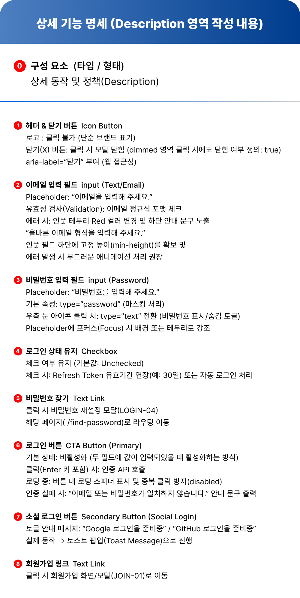

# 로그인 모달 (login-page v1.2 화면 설계 기반)

---

## 화면 설계도 (login-page v1.2)




---

### 테스트 계정

아래 계정으로 로그인하면 성공합니다. (`script.ts`의 `DEMO_ACCOUNTS` 배열에서 추가 · 수정)

| 이메일 | 비밀번호 |
|--------|----------|
| `demo@myapp.com` | `demo1234` |
| `test@example.com` | `test5678` |

---

| 화면 ID | 화면명 | 파일명 | 화면 유형 | 설계도 파일 |
|---------|--------|--------|-----------|-------------|
| LOGIN-02 | 로그인 모달 (Login Modal) | `index.html` | 레이어 팝업 (Dimmed Modal) | `img/login-page-v1.2.0.png` ~ `v1.2.2.png` |

> 설계도의 파일명 칸에는 `index.html 또는 /components/LoginModal.tsx`로 적혀 있습니다. 이 실습은 **HTML · CSS · JavaScript**만 사용하므로 `index.html`로 구현합니다.

| 이미지 | 내용 |
|--------|------|
| `login-page-v1.2.1.png` | 화면 미리보기만 확대한 이미지 (번호 ①~⑧ 표시) |
| `login-page-v1.2.2.png` | 상세 기능 명세(Description)만 확대한 이미지 |

---

## 프로젝트 개요

v1.0에서 만든 **카드형 로그인 화면**을, 페이지 위에 떠 있는 **로그인 모달(레이어 팝업)** 로 발전시킨 버전입니다.
배경을 어둡게 덮는 dimmed 영역, 닫기 버튼, 비밀번호 보기 토글, 로그인 상태 유지, 소셜 로그인 버튼 등 실제 서비스에서 자주 쓰는 요소를 추가했습니다.

---

## v1.0 → v1.2 달라진 점

| 구분 | v1.0 | v1.2 |
|------|------|------|
| 화면 유형 | 페이지 정중앙 카드 | **레이어 팝업 (Dimmed Modal)** |
| 헤더 | 제목 텍스트 `Opus 5.5` | 브랜드 로고 `Gemini` + **닫기(X) 버튼** |
| 입력칸 | placeholder만 있음 | **라벨(`이메일` / `비밀번호`)** 추가 |
| 비밀번호 | 마스킹만 | **눈 아이콘으로 표시/숨김 토글** |
| 이메일 검사 | 비어 있는지만 검사 | **정규식으로 이메일 형식 검사** |
| 부가 기능 | 없음 | 로그인 상태 유지 체크박스, 비밀번호 찾기 링크 |
| 버튼 | 로그인 하기 / 회원가입 | 로그인(Primary) + **Google · GitHub 소셜 로그인** |
| 회원가입 | 버튼 | 하단 **텍스트 링크** (`아직 회원이 아니신가요? → 회원가입`) |
| 로그인 버튼 상태 | 항상 활성 | **두 칸 모두 입력해야 활성화**, 로딩 중 비활성화 |

---

## 프로젝트의 목적

- **모달 열기 / 닫기** 흐름 익히기 (닫기 버튼, dimmed 영역 클릭)
- `type` 속성을 JavaScript로 바꿔 **비밀번호 표시/숨김 토글** 구현하기
- **정규식**으로 이메일 형식을 검사하고, 에러 상태를 CSS 클래스로 표현하기
- 입력 상태에 따라 버튼의 **`disabled` 속성을 켜고 끄기**
- 토스트 메시지처럼 **잠깐 나타났다 사라지는 UI** 만들기
- `aria-label` 등 **웹 접근성** 속성을 의식하며 마크업하기

---

## 화면 구성 (설계도 미리보기 기준)

| 번호 | 요소 | 모습 |
|------|------|------|
| 배경 | dimmed 영역 | 위는 연한 회색 → 아래는 파란색으로 이어지는 그라데이션 |
| - | 모달 카드 | 흰색, 모서리가 크게 둥근 카드가 화면 중앙에 위치 |
| ① | 헤더 | 왼쪽 `✦ Gemini` 로고, 오른쪽 파란 원형 닫기(X) 버튼, 아래 파란 구분선 |
| ② | 이메일 입력 | 라벨 `이메일` + 파란 테두리 입력칸, placeholder `이메일을 입력해 주세요.` |
| ③ | 비밀번호 입력 | 라벨 `비밀번호` + 입력칸, placeholder `비밀번호를 입력해 주세요.`, 오른쪽에 눈 아이콘 |
| ④ | 로그인 상태 유지 | 왼쪽 체크박스 + `로그인 상태 유지` |
| ⑤ | 비밀번호 찾기 | 같은 줄 오른쪽 끝 텍스트 링크 |
| ⑥ | 로그인 버튼 | 파란 배경 + 흰색 굵은 글씨, 입력칸과 같은 너비 |
| - | 구분선 | 로그인 버튼과 소셜 로그인 사이 가로선 |
| ⑦ | 소셜 로그인 | `Google` · `GitHub` 버튼 2개 나란히, 흰 배경 + 검정 테두리 + 아이콘 |
| ⑧ | 회원가입 링크 | `아직 회원이 아니신가요? → 회원가입` (회원가입만 파란 굵은 글씨) |

---

## 상세 기능 명세

### ① 헤더 & 닫기 버튼 — Icon Button

| 항목 | 명세 |
|------|------|
| 로고 | 클릭 불가 (단순 브랜드 표기) |
| 닫기(X) 버튼 | 클릭 시 모달 닫힘 |
| dimmed 영역 클릭 | 모달 닫힘 (`true`) |
| 접근성 | `aria-label="닫기"` 부여 |

### ② 이메일 입력 필드 — input (Text/Email)

| 항목 | 명세 |
|------|------|
| placeholder | `이메일을 입력해 주세요.` |
| 유효성 검사 | 이메일 **정규식** 포맷 체크 |
| 에러 시 | 입력칸 테두리 **빨간색**으로 변경 + 하단 안내 문구 노출 |
| 에러 문구 | `올바른 이메일 형식을 입력해 주세요.` |
| 레이아웃 | 입력칸 하단에 고정 높이(`min-height`) 확보 → 에러가 나도 화면이 흔들리지 않게 |
| 애니메이션 | 에러 발생 시 부드러운 애니메이션 권장 |

### ③ 비밀번호 입력 필드 — input (Password)

| 항목 | 명세 |
|------|------|
| placeholder | `비밀번호를 입력해 주세요.` |
| 기본 속성 | `type="password"` (마스킹 처리) |
| 눈 아이콘 클릭 | `type="text"`로 전환 (표시 / 숨김 토글) |
| focus | 배경 또는 테두리로 강조 |

### ④ 로그인 상태 유지 — Checkbox

| 항목 | 명세 |
|------|------|
| 기본값 | 체크 해제 (Unchecked) |
| 체크 시 | Refresh Token 유효기간 연장(예: 30일) 또는 자동 로그인 처리 |

### ⑤ 비밀번호 찾기 — Text Link

| 항목 | 명세 |
|------|------|
| 클릭 시 | 비밀번호 재설정 모달(LOGIN-04) 또는 `/find-password` 페이지로 이동 |

### ⑥ 로그인 버튼 — CTA Button (Primary)

| 항목 | 명세 |
|------|------|
| 기본 상태 | **비활성화** — 두 필드에 값이 모두 입력되면 활성화 |
| 클릭 (Enter 키 포함) | 인증 API 호출 |
| 로딩 중 | 버튼 안에 로딩 스피너 표시 + 중복 클릭 방지(`disabled`) |
| 인증 실패 | `이메일 또는 비밀번호가 일치하지 않습니다.` 안내 문구 출력 |

### ⑦ 소셜 로그인 버튼 — Secondary Button (Social Login)

| 항목 | 명세 |
|------|------|
| 버튼 | `Google`, `GitHub` |
| 클릭 시 | 토스트 팝업(Toast Message)으로 안내 |
| 안내 문구 | `Google 로그인을 준비중` / `GitHub 로그인을 준비중` |

### ⑧ 회원가입 링크 — Text Link

| 항목 | 명세 |
|------|------|
| 클릭 시 | 회원가입 화면 / 모달(JOIN-01)로 이동 |

---

## 구현 체크리스트

### HTML

- [x] dimmed 배경(오버레이) + 모달 카드 컨테이너 작성
- [x] 헤더: 로고 + 닫기 버튼(`aria-label="닫기"`)
- [x] 이메일 · 비밀번호 `<label>` + `<input>` 연결 (`for` ↔ `id`)
- [x] 각 input 아래 에러 문구 요소 작성
- [x] 비밀번호 입력칸 안에 눈 아이콘 버튼 작성
- [x] 로그인 상태 유지 체크박스 + 비밀번호 찾기 링크
- [x] 로그인 버튼 (`type="submit"`, 처음엔 `disabled`)
- [x] Google · GitHub 소셜 로그인 버튼
- [x] 회원가입 링크
- [x] 토스트 메시지 요소

### CSS

- [x] dimmed 배경을 화면 전체에 고정(`position: fixed`) + 그라데이션
- [x] 모달 카드 화면 중앙 배치, 큰 `border-radius`
- [x] 헤더 아래 파란 구분선
- [x] input `:focus` 시 테두리 · 배경 강조
- [x] 에러 상태 클래스: 테두리 빨간색 + 에러 문구 표시
- [x] 에러 문구 칸 `min-height` 확보 + 부드러운 등장 애니메이션
- [x] 눈 아이콘을 비밀번호 입력칸 오른쪽 안에 배치
- [x] 체크박스 줄: 왼쪽 / 오른쪽 양 끝 정렬
- [x] 로그인 버튼 활성 / 비활성(`:disabled`) / 로딩 스타일
- [x] 소셜 버튼 2개 나란히 배치
- [x] 토스트 메시지 숨김 / 표시 상태
- [x] 브라우저 기본 비밀번호 표시 버튼(`::-ms-reveal`) 숨김

### JavaScript

- [x] 닫기 버튼 · dimmed 영역 클릭 시 모달 닫기 (카드 안쪽 클릭은 닫히지 않게)
- [x] 이메일 정규식 검사 → 에러 클래스 추가 / 제거
- [x] 눈 아이콘 클릭 시 `type` 을 `password` ↔ `text` 전환
- [x] 두 입력칸에 값이 모두 있을 때만 로그인 버튼 활성화
- [x] 로그인 제출(클릭 · Enter) 시 로딩 상태 → 결과 처리
- [x] 인증 실패 시 안내 문구 출력
- [x] 소셜 로그인 버튼 클릭 시 토스트 메시지 표시 후 자동으로 사라지기

---

## HTML · CSS · JS 연결 지점

코드 주석의 `[연결①]`~`[연결⑩]` 번호와 같습니다. **세 파일에서 철자가 정확히 같아야** 합니다.

| 연결 | HTML | CSS | TypeScript (`script.ts`) |
|------|------|-----|------------|
| [연결①] 모달 열기 | `id="loginOverlay"`, `id="openModalBtn"` | - | `$('loginOverlay')`, `openModal()` |
| [연결②] 모달 표시 상태 | `class="overlay is-open"` | `.overlay.is-open` | `classList.add` / `remove('is-open')` |
| [연결③] 닫기 버튼 | `id="closeModalBtn"`, `aria-label="닫기"` | `.btn-close` | `closeBtn.addEventListener('click', closeModal)` |
| [연결④] 로그인 제출 | `id="loginForm"`, `type="submit"` | - | `form.addEventListener('submit', …)` |
| [연결⑤] 에러 상태 | `id="emailField"` · `id="emailError"` | `.field.is-invalid` | `setFieldError()` → `classList.add('is-invalid')` |
| [연결⑥] 비밀번호 토글 | `id="eyeBtn"`, `aria-pressed` | `.btn-eye[aria-pressed="true"]` | `password.type` 전환 + `aria-pressed` 변경 |
| [연결⑦] 로그인 상태 유지 | `id="rememberMe"` | - | `remember.checked` |
| [연결⑧] 로그인 버튼 | `id="loginBtn"`, `disabled` | `:disabled`, `.is-loading` | `loginBtn.disabled`, `classList.toggle('is-loading')` |
| [연결⑨] 소셜 로그인 | `data-provider="Google"` / `"GitHub"` | `.btn-social` | `btn.dataset.provider` (`Provider` 타입) |
| [연결⑩] 토스트 | `id="toast"` | `.toast.show` | `showToast()` |
| CSS 변수 | - | `:root`의 `--primary`, `--error` 등 | - |

---

## 설계 확인 메모

구현 전에 정해야 했던 부분과, 이번 구현에서 정한 내용입니다.

| 질문 | 이번 구현에서 정한 내용 |
|------|------------------------|
| 인증 API | `fakeLoginApi()`가 1.2초 기다린 뒤 `script.ts`의 `DEMO_ACCOUNTS` 목록과 비교 (아래 테스트 계정) |
| 로그인 상태 유지 | 성공 시 체크되어 있으면 이메일을 `localStorage`에 저장 → 다음 방문 때 자동 입력 |
| 비밀번호 찾기 · 회원가입 | 아직 화면이 없으므로 토스트로 `준비중` 안내 |
| 이메일 검사 시점 | 칸을 벗어날 때(`blur`) + 제출할 때, 다시 입력하면 에러 지움 |
| 비밀번호 규칙 | 형식 검사 없음 (설계도에 규칙이 없음) |
| 모달 다시 열기 | 뒤 페이지에 `로그인 열기` 버튼 추가 |
| ESC 키 | 모달 닫기 추가 |


<details>
<summary>처음 정리했던 확인 목록</summary>


- **인증 API가 없음**: 서버가 없으므로 "로그인 성공 / 실패"를 판단할 기준이 필요합니다. 예: 미리 정해 둔 테스트 이메일 · 비밀번호와 비교하고, `setTimeout`으로 로딩 시간을 흉내 냅니다.
- **Refresh Token 연장**: 서버 기능이라 프론트엔드만으로는 구현할 수 없습니다. 이번 버전에서는 체크 여부만 읽어 두거나 `localStorage`에 저장하는 정도로 범위를 정합니다.
- **비밀번호 찾기 이동 방식**: 설계도에 "재설정 모달(LOGIN-04)"과 "`/find-password` 페이지 이동"이 함께 적혀 있습니다. 둘 중 하나로 정합니다.
- **에러 검사 시점**: 이메일 형식 검사를 입력할 때마다 할지, 칸을 벗어날 때(`blur`) 할지, 제출할 때 할지 정합니다.
- **비밀번호 검사 규칙**: 명세에는 비밀번호 형식 규칙이 없습니다. 필요하면 최소 글자 수 등을 정합니다.
- **모달 다시 열기**: 닫은 뒤 다시 여는 버튼이 설계도에 없습니다. 실습 확인용으로 "로그인 열기" 버튼을 둘지 정합니다.
- **ESC 키 닫기**: 명세에는 없지만 모달에서 흔히 쓰는 동작입니다. 추가할지 정합니다.

</details>

---

## 기본 파일 구조

```
login-page/
├── img/
│   ├── login-page-v1.0.png
│   ├── login-page-v1.2.0.png   ← 전체 설계도
│   ├── login-page-v1.2.1.png   ← 화면 미리보기
│   └── login-page-v1.2.2.png   ← 상세 기능 명세
├── v1.0/
└── v1.2/
    ├── README.md
    ├── index.html              ← 모달 마크업
    ├── style.css               ← dimmed · 모달 · 입력칸 · 버튼 · 토스트 스타일
    ├── script.ts               ← 원본 코드 (TypeScript) — 여기를 수정
    ├── script.js               ← script.ts를 빌드한 결과물 (index.html이 불러옴)
    └── tsconfig.json           ← TypeScript 빌드 설정
```

---

## 기술 스택

- **HTML5**: `form`, `label`, `input`(email · password · checkbox), `button`, `aria-label`, `data-*`
- **CSS3**: `position: fixed` 오버레이, Flexbox, `linear-gradient`, CSS 변수, `:focus` · `:hover` · `:disabled`, `transition` / `@keyframes`
- **JavaScript (ES2020)**: `addEventListener`, `classList`, 정규식(`RegExp.test`), `disabled` 속성, `dataset`, `Promise` · `async/await`, `localStorage`
- **TypeScript**: `strict` 모드, 제네릭 요소 찾기 함수 `$<T>()`, `interface`, 유니언 타입(`Provider`)

---

## 빌드 방법 (TypeScript → JavaScript)

브라우저는 `.ts` 파일을 직접 실행하지 못하므로, `script.ts`를 수정한 뒤에는 **꼭 다시 빌드**해야 화면에 반영됩니다. 저장소 루트에서 실행합니다.

```bash
npx tsc -p 02-web-study/login-page/v1.2
```

> TypeScript 버전은 저장소 루트 `package.json`의 `devDependencies.typescript`에서 정해집니다. 빌드 설정은 `v1.2/tsconfig.json`에 있습니다.

---

## 실행 방법

`index.html`을 VS Code **Live Server** 등 로컬 서버로 열어 확인합니다.

```
login-page/v1.2/index.html
```

> 수정 후 화면이 바뀌지 않으면 브라우저 캐시 때문일 수 있습니다. `Ctrl + Shift + R`(강력 새로고침)로 다시 불러오세요.

---

## 작업 내역

### 1. README 작성 — 설계도 정리

- 설계도 이미지 3장(`v1.2.0` ~ `v1.2.2`)을 바탕으로 화면 정보, 화면 구성 ①~⑧, 상세 기능 명세, 구현 체크리스트를 정리
- 기존 제목의 `v2.0` 표기를 설계도와 같은 **`v1.2`** 로 수정
- 설계도 파일명 칸의 `index.html 또는 /components/LoginModal.tsx` 중 **`index.html`** 기준으로 진행

### 2. 로그인 모달 구현 — HTML · CSS · TypeScript

| 파일 | 작업 내용 |
|------|-----------|
| `index.html` | dimmed 오버레이 + 모달 카드, 라벨 · 입력칸 · 에러 문구 자리, 눈 아이콘 버튼, 체크박스 줄, 로그인 버튼(처음엔 `disabled`), 소셜 버튼(`data-provider`), 회원가입 링크, 토스트. 아이콘은 모두 인라인 SVG |
| `style.css` | CSS 변수로 색 · 둥글기 관리, dimmed 그라데이션, `:focus` 강조, `.is-invalid` 에러 상태, `min-height`로 에러 문구 자리 확보, `:disabled` · `.is-loading` 스피너, 토스트, 480px 이하 모바일 대응 |
| `script.ts` | 모달 열기/닫기(X · dimmed · ESC), 이메일 정규식 검사(`blur` · 제출), 버튼 활성화, 비밀번호 표시 토글, 가짜 로그인 API + 로딩, 로그인 상태 유지(`localStorage`), 링크 · 소셜 버튼 토스트 |
| `tsconfig.json` | `strict` 모드, `script.ts` → 같은 폴더의 `script.js`로 빌드 (`dist/`는 `.gitignore` 대상이라 사용하지 않음) |

- 요소 찾기 함수 `$<T>(id)`: 요소가 없으면 `null` 대신 **`#id 요소를 찾을 수 없습니다.`** 에러를 던져서 id 오타를 콘솔에서 바로 알 수 있게 함
- 미리보기용 로컬 서버 설정 추가: `.claude/launch.json`의 `login-page-v1.2` (포트 `5522`)

### 3. 테스트 계정 여러 개 지원

- 계정 1개를 담던 `DEMO_ACCOUNT` → 배열 **`DEMO_ACCOUNTS`** 로 변경
- `fakeLoginApi()`가 `DEMO_ACCOUNTS.some(...)`으로 **목록 중 하나라도 일치하면 성공**
- 이메일은 대소문자를 구분하지 않고(`toLowerCase()`), 비밀번호는 정확히 같아야 함

```ts
const DEMO_ACCOUNTS: readonly DemoAccount[] = [
    { email: 'demo@myapp.com',   password: 'demo1234' },
    { email: 'test@example.com', password: 'test5678' },
];
```

| 입력 | 결과 |
|------|------|
| `demo@myapp.com` / `demo1234` | ✅ 성공 |
| `test@example.com` / `test5678` | ✅ 성공 |
| `test@example.com` / `demo1234` (다른 계정의 비밀번호) | ❌ `이메일 또는 비밀번호가 일치하지 않습니다.` |
| `DEMO@myapp.com` / `demo1234` | ✅ 성공 (대소문자 무시) |

### 4. 브라우저 기본 비밀번호 표시 버튼 제거

```css
.input::-ms-reveal,
.input::-ms-clear { display: none; }
```

**에러 일지**

| 항목 | 내용 |
|------|------|
| 증상 | 비밀번호 칸에 눈 아이콘이 두 개 겹쳐 보임 |
| 원인 | Edge가 `type="password"` 입력칸에 자체 표시 버튼(`::-ms-reveal`)을 자동으로 붙임 → 직접 만든 `.btn-eye`와 같은 자리에 겹침 |
| 해결 | `::-ms-reveal`, `::-ms-clear`를 `display: none`으로 숨겨 직접 만든 아이콘만 남김 |
| 다음에 먼저 확인할 것 | 브라우저마다 기본으로 붙이는 UI가 다르므로, 같은 화면을 **Chrome · Edge 둘 다**에서 열어 보기. F12 → Elements에서 input 안의 `#shadow-root`를 펼치면 브라우저가 넣은 요소가 보임 |

> `-ms-` 선택자는 Chrome이 모르는 이름이라 무시됩니다. 다른 선택자와 쉼표로 묶으면 **규칙 전체가 무시**되므로 따로 작성합니다.

### 확인한 동작

| 동작 | 결과 |
|------|------|
| 처음 열었을 때 로그인 버튼 | 비활성, 두 칸을 모두 입력하면 활성 |
| 잘못된 이메일 형식 | 빨간 테두리 + `올바른 이메일 형식을 입력해 주세요.` |
| 눈 아이콘 클릭 | 비밀번호 표시/숨김 + 아이콘 교체 |
| 로그인 클릭 | 스피너 표시 + 버튼 잠금 → 결과 처리 |
| 닫기(X) · dimmed 영역 · ESC | 모달 닫힘 (카드 안쪽 클릭은 닫히지 않음) |
| 소셜 버튼 · 링크 | `준비중` 토스트 문구 출력 |
| 콘솔 | 에러 없음 |
| Edge 기본 눈 아이콘 숨김 | ⏳ Edge에서 직접 확인 필요 (미리보기 창은 Chrome 기반이라 확인 불가) |
