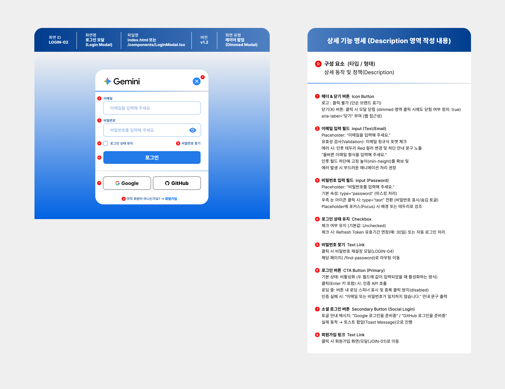
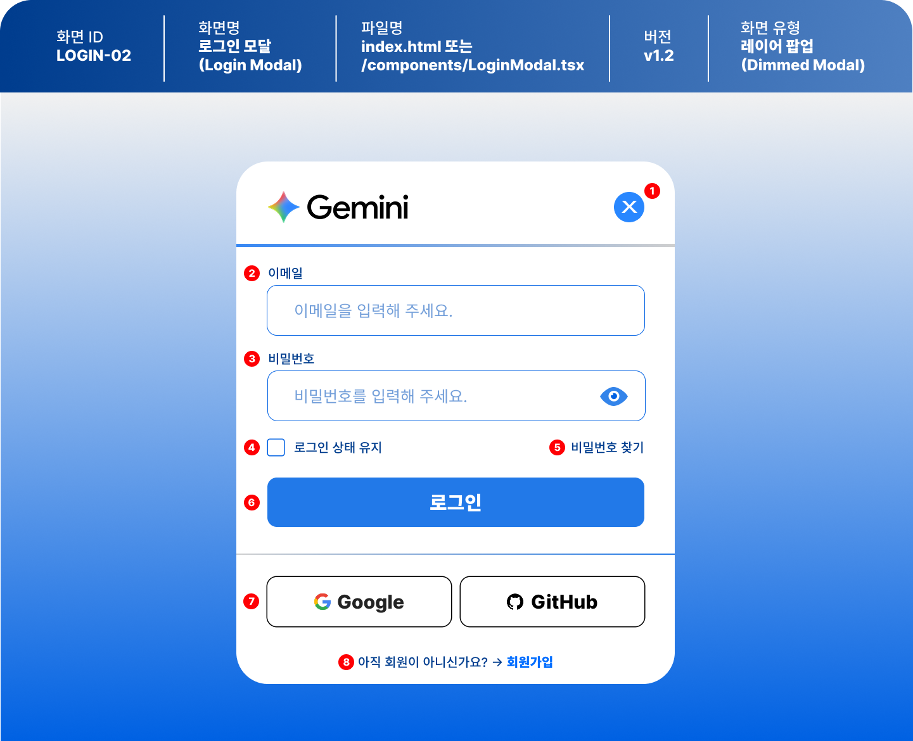

# 로그인 모달 (login-page v1.2 화면 설계 기반)

---

## 화면 설계도 (login-page v1.2)






| 화면 ID | 화면명 | 파일명 | 화면 유형 | 설계도 파일 |
|---------|--------|--------|-----------|-------------|
| LOGIN-02 | 로그인 모달 (Login Modal) | `index.html` | 레이어 팝업 (Dimmed Modal) | `img/login-page-v1.2.0.png` ~ `v1.2.2.png` |

> 설계도의 파일명 칸에는 `index.html 또는 /components/LoginModal.tsx`로 적혀 있습니다. 이 실습은 **HTML · CSS · JavaScript**만 사용하므로 `index.html`로 구현합니다.

| 이미지 | 내용 |
|--------|------|
| `login-page-v1.2.0.png` | 화면 미리보기 + 상세 기능 명세를 한 장에 모은 전체 설계도 |
| `login-page-v1.2.1.png` | 화면 미리보기만 확대한 이미지 (번호 ①~⑧ 표시) |
| `login-page-v1.2.2.png` | 상세 기능 명세(Description)만 확대한 이미지 |

---

## 프로젝트 개요

v1.0에서 만든 **카드형 로그인 화면**을, 페이지 위에 떠 있는 **로그인 모달(레이어 팝업)** 로 발전시킨 버전입니다.
배경을 어둡게 덮는 dimmed 영역, 닫기 버튼, 비밀번호 보기 토글, 로그인 상태 유지, 소셜 로그인 버튼 등 실제 서비스에서 자주 쓰는 요소를 추가했습니다.

---

## v1.0 → v1.2 달라진 점

| 구분 | v1.0 | v1.2 |
|------|------|------|
| 화면 유형 | 페이지 정중앙 카드 | **레이어 팝업 (Dimmed Modal)** |
| 헤더 | 제목 텍스트 `Opus 5.5` | 브랜드 로고 `Gemini` + **닫기(X) 버튼** |
| 입력칸 | placeholder만 있음 | **라벨(`이메일` / `비밀번호`)** 추가 |
| 비밀번호 | 마스킹만 | **눈 아이콘으로 표시/숨김 토글** |
| 이메일 검사 | 비어 있는지만 검사 | **정규식으로 이메일 형식 검사** |
| 부가 기능 | 없음 | 로그인 상태 유지 체크박스, 비밀번호 찾기 링크 |
| 버튼 | 로그인 하기 / 회원가입 | 로그인(Primary) + **Google · GitHub 소셜 로그인** |
| 회원가입 | 버튼 | 하단 **텍스트 링크** (`아직 회원이 아니신가요? → 회원가입`) |
| 로그인 버튼 상태 | 항상 활성 | **두 칸 모두 입력해야 활성화**, 로딩 중 비활성화 |

---

## 프로젝트의 목적

- **모달 열기 / 닫기** 흐름 익히기 (닫기 버튼, dimmed 영역 클릭)
- `type` 속성을 JavaScript로 바꿔 **비밀번호 표시/숨김 토글** 구현하기
- **정규식**으로 이메일 형식을 검사하고, 에러 상태를 CSS 클래스로 표현하기
- 입력 상태에 따라 버튼의 **`disabled` 속성을 켜고 끄기**
- 토스트 메시지처럼 **잠깐 나타났다 사라지는 UI** 만들기
- `aria-label` 등 **웹 접근성** 속성을 의식하며 마크업하기

---

## 화면 구성 (설계도 미리보기 기준)

| 번호 | 요소 | 모습 |
|------|------|------|
| 배경 | dimmed 영역 | 위는 연한 회색 → 아래는 파란색으로 이어지는 그라데이션 |
| - | 모달 카드 | 흰색, 모서리가 크게 둥근 카드가 화면 중앙에 위치 |
| ① | 헤더 | 왼쪽 `✦ Gemini` 로고, 오른쪽 파란 원형 닫기(X) 버튼, 아래 파란 구분선 |
| ② | 이메일 입력 | 라벨 `이메일` + 파란 테두리 입력칸, placeholder `이메일을 입력해 주세요.` |
| ③ | 비밀번호 입력 | 라벨 `비밀번호` + 입력칸, placeholder `비밀번호를 입력해 주세요.`, 오른쪽에 눈 아이콘 |
| ④ | 로그인 상태 유지 | 왼쪽 체크박스 + `로그인 상태 유지` |
| ⑤ | 비밀번호 찾기 | 같은 줄 오른쪽 끝 텍스트 링크 |
| ⑥ | 로그인 버튼 | 파란 배경 + 흰색 굵은 글씨, 입력칸과 같은 너비 |
| - | 구분선 | 로그인 버튼과 소셜 로그인 사이 가로선 |
| ⑦ | 소셜 로그인 | `Google` · `GitHub` 버튼 2개 나란히, 흰 배경 + 검정 테두리 + 아이콘 |
| ⑧ | 회원가입 링크 | `아직 회원이 아니신가요? → 회원가입` (회원가입만 파란 굵은 글씨) |

---

## 상세 기능 명세

### ① 헤더 & 닫기 버튼 — Icon Button

| 항목 | 명세 |
|------|------|
| 로고 | 클릭 불가 (단순 브랜드 표기) |
| 닫기(X) 버튼 | 클릭 시 모달 닫힘 |
| dimmed 영역 클릭 | 모달 닫힘 (`true`) |
| 접근성 | `aria-label="닫기"` 부여 |

### ② 이메일 입력 필드 — input (Text/Email)

| 항목 | 명세 |
|------|------|
| placeholder | `이메일을 입력해 주세요.` |
| 유효성 검사 | 이메일 **정규식** 포맷 체크 |
| 에러 시 | 입력칸 테두리 **빨간색**으로 변경 + 하단 안내 문구 노출 |
| 에러 문구 | `올바른 이메일 형식을 입력해 주세요.` |
| 레이아웃 | 입력칸 하단에 고정 높이(`min-height`) 확보 → 에러가 나도 화면이 흔들리지 않게 |
| 애니메이션 | 에러 발생 시 부드러운 애니메이션 권장 |

### ③ 비밀번호 입력 필드 — input (Password)

| 항목 | 명세 |
|------|------|
| placeholder | `비밀번호를 입력해 주세요.` |
| 기본 속성 | `type="password"` (마스킹 처리) |
| 눈 아이콘 클릭 | `type="text"`로 전환 (표시 / 숨김 토글) |
| focus | 배경 또는 테두리로 강조 |

### ④ 로그인 상태 유지 — Checkbox

| 항목 | 명세 |
|------|------|
| 기본값 | 체크 해제 (Unchecked) |
| 체크 시 | Refresh Token 유효기간 연장(예: 30일) 또는 자동 로그인 처리 |

### ⑤ 비밀번호 찾기 — Text Link

| 항목 | 명세 |
|------|------|
| 클릭 시 | 비밀번호 재설정 모달(LOGIN-04) 또는 `/find-password` 페이지로 이동 |

### ⑥ 로그인 버튼 — CTA Button (Primary)

| 항목 | 명세 |
|------|------|
| 기본 상태 | **비활성화** — 두 필드에 값이 모두 입력되면 활성화 |
| 클릭 (Enter 키 포함) | 인증 API 호출 |
| 로딩 중 | 버튼 안에 로딩 스피너 표시 + 중복 클릭 방지(`disabled`) |
| 인증 실패 | `이메일 또는 비밀번호가 일치하지 않습니다.` 안내 문구 출력 |

### ⑦ 소셜 로그인 버튼 — Secondary Button (Social Login)

| 항목 | 명세 |
|------|------|
| 버튼 | `Google`, `GitHub` |
| 클릭 시 | 토스트 팝업(Toast Message)으로 안내 |
| 안내 문구 | `Google 로그인을 준비중` / `GitHub 로그인을 준비중` |

### ⑧ 회원가입 링크 — Text Link

| 항목 | 명세 |
|------|------|
| 클릭 시 | 회원가입 화면 / 모달(JOIN-01)로 이동 |

---

## 구현 체크리스트

### HTML

- [ ] dimmed 배경(오버레이) + 모달 카드 컨테이너 작성
- [ ] 헤더: 로고 + 닫기 버튼(`aria-label="닫기"`)
- [ ] 이메일 · 비밀번호 `<label>` + `<input>` 연결 (`for` ↔ `id`)
- [ ] 각 input 아래 에러 문구 요소 작성
- [ ] 비밀번호 입력칸 안에 눈 아이콘 버튼 작성
- [ ] 로그인 상태 유지 체크박스 + 비밀번호 찾기 링크
- [ ] 로그인 버튼 (`type="submit"`, 처음엔 `disabled`)
- [ ] Google · GitHub 소셜 로그인 버튼
- [ ] 회원가입 링크
- [ ] 토스트 메시지 요소

### CSS

- [ ] dimmed 배경을 화면 전체에 고정(`position: fixed`) + 그라데이션
- [ ] 모달 카드 화면 중앙 배치, 큰 `border-radius`
- [ ] 헤더 아래 파란 구분선
- [ ] input `:focus` 시 테두리 · 배경 강조
- [ ] 에러 상태 클래스: 테두리 빨간색 + 에러 문구 표시
- [ ] 에러 문구 칸 `min-height` 확보 + 부드러운 등장 애니메이션
- [ ] 눈 아이콘을 비밀번호 입력칸 오른쪽 안에 배치
- [ ] 체크박스 줄: 왼쪽 / 오른쪽 양 끝 정렬
- [ ] 로그인 버튼 활성 / 비활성(`:disabled`) / 로딩 스타일
- [ ] 소셜 버튼 2개 나란히 배치
- [ ] 토스트 메시지 숨김 / 표시 상태

### JavaScript

- [ ] 닫기 버튼 · dimmed 영역 클릭 시 모달 닫기 (카드 안쪽 클릭은 닫히지 않게)
- [ ] 이메일 정규식 검사 → 에러 클래스 추가 / 제거
- [ ] 눈 아이콘 클릭 시 `type` 을 `password` ↔ `text` 전환
- [ ] 두 입력칸에 값이 모두 있을 때만 로그인 버튼 활성화
- [ ] 로그인 제출(클릭 · Enter) 시 로딩 상태 → 결과 처리
- [ ] 인증 실패 시 안내 문구 출력
- [ ] 소셜 로그인 버튼 클릭 시 토스트 메시지 표시 후 자동으로 사라지기

---

## HTML · CSS · JS 연결 지점 (계획)

이름(id · class)은 직접 정하되, **세 파일에서 철자가 정확히 같아야** 합니다.

| 연결 | HTML | CSS | JavaScript |
|------|------|-----|------------|
| [연결①] 모달 열림/닫힘 | dimmed 배경 · 모달의 `id` | 숨김 상태 클래스 스타일 | `classList.add` / `remove` |
| [연결②] 닫기 버튼 | 닫기 버튼의 `id`, `aria-label` | 원형 파란 버튼 | `addEventListener('click', …)` |
| [연결③] 입력칸 | `<label for>` ↔ `<input id>` | `:focus` 스타일 | `getElementById`로 값 읽기 |
| [연결④] 에러 상태 | 입력칸 · 에러 문구 요소 | 에러 클래스(빨간 테두리 · 문구 표시) | 정규식 검사 후 `classList.toggle` |
| [연결⑤] 비밀번호 토글 | 눈 아이콘 버튼, 비밀번호 input | 아이콘 위치 | `input.type = 'text'` / `'password'` |
| [연결⑥] 로그인 버튼 | 버튼의 `disabled` 속성 | `:disabled` 스타일, 로딩 스타일 | `button.disabled = true / false` |
| [연결⑦] 소셜 버튼 · 토스트 | `data-provider="Google"` 같은 `data-*` 속성, 토스트 요소 | 토스트 표시 클래스 | `dataset.provider` 읽어서 문구 만들기 |
| [연결⑧] CSS 변수 | - | `:root`의 `--변수` (파란색 · 빨간색 · 둥글기) | - |

---

## 설계 확인 메모

구현 전에 정해야 할 부분입니다.

- **인증 API가 없음**: 서버가 없으므로 "로그인 성공 / 실패"를 판단할 기준이 필요합니다. 예: 미리 정해 둔 테스트 이메일 · 비밀번호와 비교하고, `setTimeout`으로 로딩 시간을 흉내 냅니다.
- **Refresh Token 연장**: 서버 기능이라 프론트엔드만으로는 구현할 수 없습니다. 이번 버전에서는 체크 여부만 읽어 두거나 `localStorage`에 저장하는 정도로 범위를 정합니다.
- **비밀번호 찾기 이동 방식**: 설계도에 "재설정 모달(LOGIN-04)"과 "`/find-password` 페이지 이동"이 함께 적혀 있습니다. 둘 중 하나로 정합니다.
- **에러 검사 시점**: 이메일 형식 검사를 입력할 때마다 할지, 칸을 벗어날 때(`blur`) 할지, 제출할 때 할지 정합니다.
- **비밀번호 검사 규칙**: 명세에는 비밀번호 형식 규칙이 없습니다. 필요하면 최소 글자 수 등을 정합니다.
- **모달 다시 열기**: 닫은 뒤 다시 여는 버튼이 설계도에 없습니다. 실습 확인용으로 "로그인 열기" 버튼을 둘지 정합니다.
- **ESC 키 닫기**: 명세에는 없지만 모달에서 흔히 쓰는 동작입니다. 추가할지 정합니다.

---

## 기본 파일 구조

```
login-page/
├── img/
│   ├── login-page-v1.0.png
│   ├── login-page-v1.2.0.png   ← 전체 설계도
│   ├── login-page-v1.2.1.png   ← 화면 미리보기
│   └── login-page-v1.2.2.png   ← 상세 기능 명세
├── v1.0/
└── v1.2/
    ├── README.md
    ├── index.html              ← 모달 마크업
    ├── style.css               ← dimmed · 모달 · 입력칸 · 버튼 · 토스트 스타일
    └── script.js               ← 모달 닫기 · 검사 · 토글 · 토스트
```

---

## 기술 스택

- **HTML5**: `form`, `label`, `input`(email · password · checkbox), `button`, `aria-label`, `data-*`
- **CSS3**: `position: fixed` 오버레이, Flexbox, `linear-gradient`, CSS 변수, `:focus` · `:hover` · `:disabled`, `transition` / `@keyframes`
- **JavaScript (ES6+)**: `addEventListener`, `classList`, 정규식(`RegExp.test`), `disabled` 속성, `dataset`, `setTimeout`

---

## 실행 방법

`index.html`을 VS Code **Live Server** 등 로컬 서버로 열어 확인합니다.

```
login-page/v1.2/index.html
```

> 수정 후 화면이 바뀌지 않으면 브라우저 캐시 때문일 수 있습니다. `Ctrl + Shift + R`(강력 새로고침)로 다시 불러오세요.
