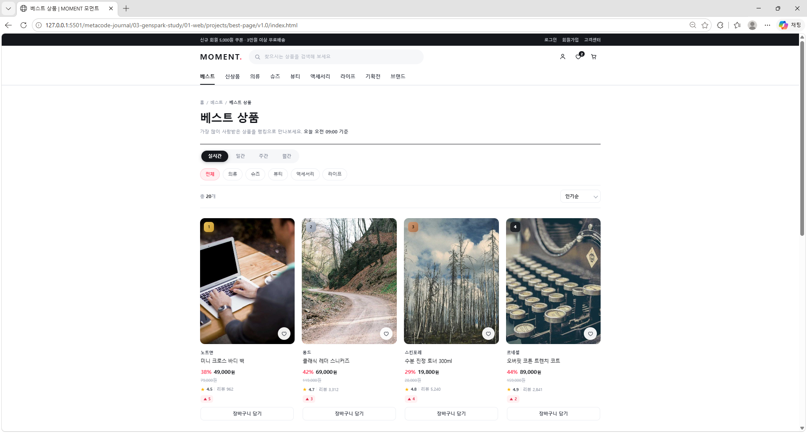
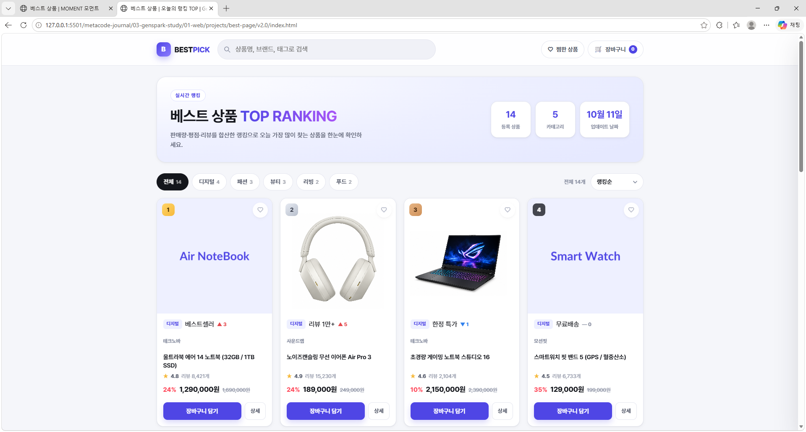
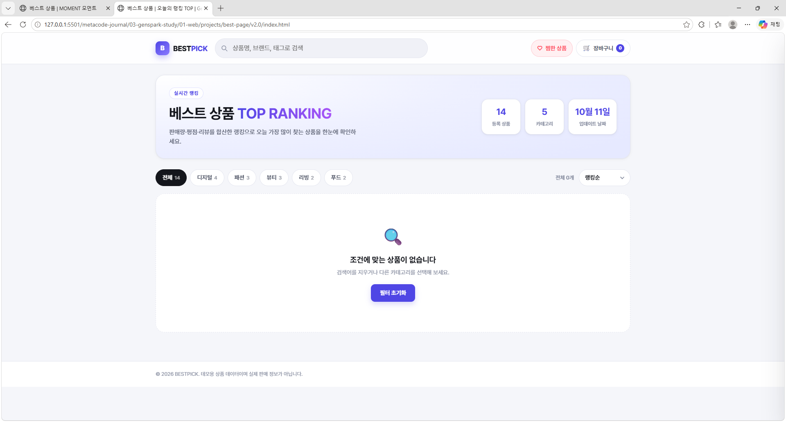
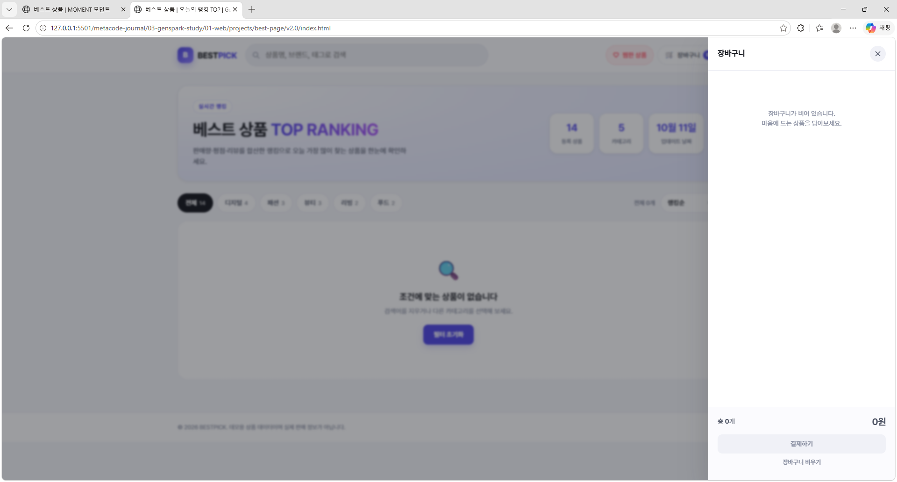
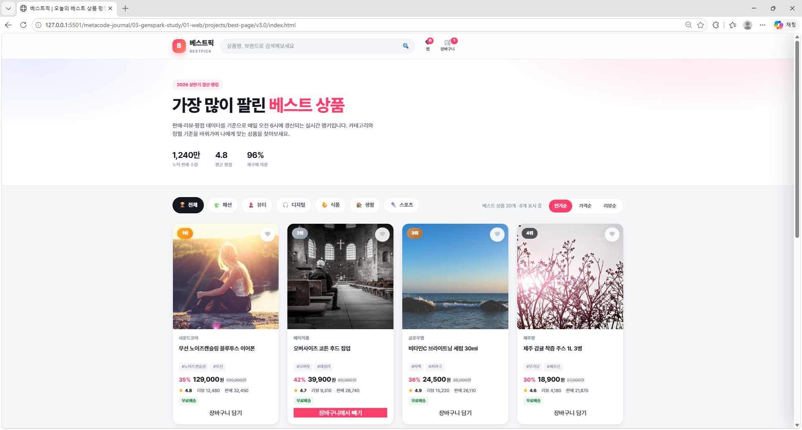
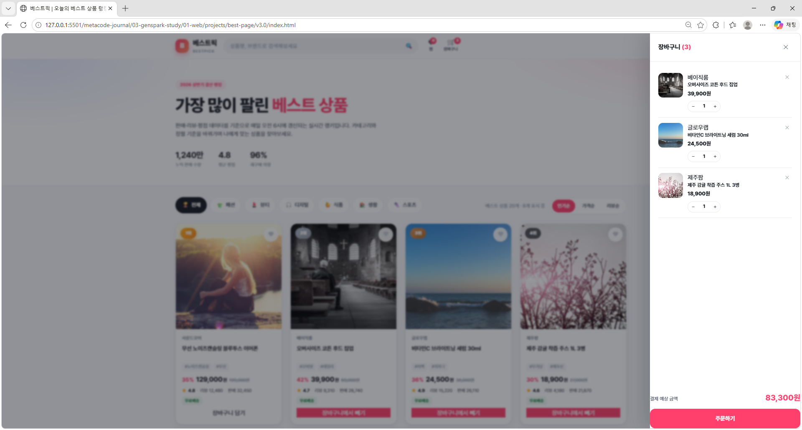
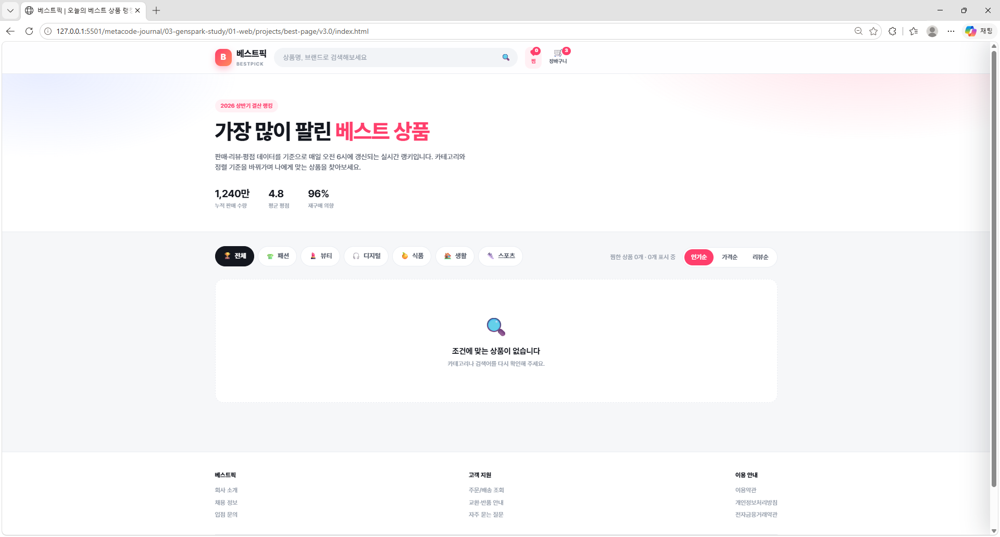

# 베스트 상품 페이지 시안 (v1.0 ~ v3.0 기반)

> 상위 문서: [Genspark 웹사이트 구현 및 개발 학습 프로젝트](../../README.md)

---

## 프로젝트 개요

이 프로젝트는 **젠스파크(Genspark)**를 통해 제공받은 웹 디자인 시안(v1.0 ~ v3.0)을 실습용으로 구현한 미니 프로젝트입니다. 본 문서는 **v1.0 ~ v3.0 시안 기반 베스트 상품 랭킹 페이지**의 README입니다.

다른 프로젝트와 달리 **TypeScript로 작성한 뒤 JavaScript로 컴파일**하는 방식으로 제작했습니다. 상품 데이터를 **필터 → 정렬 → 렌더링**하는 흐름과 타입 정의를 함께 연습합니다.

---

## 프로젝트(v1.0 ~ v3.0)의 목적

- `type` · `interface`로 **상품 데이터 구조를 타입으로 정의**하기
- 카테고리 · 기간 · 정렬 · 검색 조건을 조합해 **목록을 동적으로 렌더링**하기
- 찜 · 장바구니처럼 **사용자 상태를 저장(localStorage)**하고 화면에 반영하기
- 상품 데이터를 **JSON 파일로 분리하고 `fetch`로 불러오는 구조** 익히기 (v2.0)

---

## v1.0 - 시안 이미지



---

## v2.0 - 시안 이미지







---

## v3.0 - 시안 이미지







---

## 버전별 비교

| 구분 | v1.0 (MOMENT) | v2.0 (BESTPICK) | v3.0 (베스트픽) |
|------|------|------|------|
| 데이터 위치 | `script.ts` 안의 배열 | `data/products.json` (fetch) + HTML 내장 폴백 | `script.ts` 안의 목 데이터 |
| 필터 | 카테고리 + 기간(실시간 · 일간 · 주간 · 월간) | 카테고리 탭 + 검색 | 카테고리 탭 + 검색 |
| 정렬 | 인기 · 리뷰 · 할인율 · 낮은/높은 가격 | 정렬 옵션 | 인기순 · 가격순 · 리뷰순 |
| 장바구니 | 헤더 개수 표시 | 드로어(수량 조절 · 삭제) | 드로어(수량 조절 · 삭제 · 합계) |
| 상태 저장 | - | localStorage | localStorage |
| 컴파일 | `script.ts` → `dist/script.js` | `src/script.ts` → `dist/script.js` (ES 모듈) | `script.ts` → `script.js` |
| 추가 요소 | 순위 변동 표시 | 스켈레톤 로딩, Playwright 검증 | 금 · 은 · 동 랭킹 배지, 이미지 폴백 |

---

## 주요 기능

### v1.0

| 기능 | 설명 |
|------|------|
| 카테고리 필터 | 전체 / 의류 / 슈즈 / 뷰티 / 액세서리 / 라이프 (`data-cat`) |
| 기간 필터 | 실시간 / 일간 / 주간 / 월간 (`data-period`) 에 따라 점수 재계산 |
| 정렬 | `<select>` 값으로 인기 · 리뷰 · 할인율 · 가격순 정렬 |
| 순위 변동 | 상승 / 하락 / 신규 표시 |
| 찜 · 장바구니 | 버튼 토글 후 헤더 개수 갱신 + 토스트 |

### v2.0

| 기능 | 설명 |
|------|------|
| JSON 데이터 로딩 | `fetch('data/products.json')`, 실패 시 `index.html`에 내장된 폴백 데이터 사용 |
| 스켈레톤 UI | 데이터를 불러오는 동안 자리표시 카드 표시 |
| 카테고리 탭 · 정렬 · 검색 | 데이터에서 탭 · 정렬 옵션을 만들어 렌더링 |
| 히어로 통계 | 상품 수 · 카테고리 수 · 갱신 날짜 표시 |
| 장바구니 드로어 | 수량 변경 · 삭제, Esc 키로 닫기 |
| 상태 저장 | 찜 · 장바구니를 localStorage에 저장 |
| 빌드 · 검증 스크립트 | `inline-fallback.mjs`(폴백 주입), `build-preview.mjs`, `verify.py`(Playwright) |

### v3.0

| 기능 | 설명 |
|------|------|
| 랭킹 배지 | 1~3위는 금 · 은 · 동 메달 컬러, 4위 이하는 기본 배지 |
| 카테고리 탭 | 전체 / 패션 / 뷰티 / 디지털 / 식품 / 생활 / 스포츠 |
| 정렬 | 인기순(판매량) · 가격순(낮은 가격) · 리뷰순(리뷰 수) |
| 찜하기 | 카드 하트 토글, 헤더에서 찜한 상품만 보기 |
| 장바구니 | 담기/빼기 토글, 드로어에서 수량 조절 · 삭제 · 합계 계산 |
| 검색 | 상품명 · 브랜드 · 태그 실시간 필터 |
| 더 보기 | 8개씩 점진적 로딩 |
| 이미지 폴백 | 이미지 로드 실패 시 SVG 플레이스홀더로 자동 대체 |

---

## 기본 파일 구조

```
best-page/
├── README.md
├── images/               ← 시안 캡처 (preview-1.0 ~ preview-3.2)
├── v1.0/
│   ├── index.html
│   ├── style.css
│   ├── script.ts         ← TypeScript 원본
│   ├── dist/script.js    ← 컴파일 결과 (브라우저 실행 파일)
│   └── tsconfig.json
├── v2.0/
│   ├── index.html
│   ├── styles.css
│   ├── src/script.ts     ← TypeScript 원본
│   ├── dist/script.js    ← 컴파일 결과
│   ├── data/products.json← 상품 데이터
│   ├── images/           ← 섹션 캡처
│   ├── scripts/          ← 폴백 주입 · 미리보기 빌드 · Playwright 검증
│   ├── package.json
│   └── tsconfig.json
└── v3.0/
    ├── README.md         ← v3.0 상세 설명
    ├── index.html
    ├── style.css
    ├── script.ts         ← TypeScript 원본
    ├── script.js         ← 컴파일 결과
    └── tsconfig.json
```

---

## 기술 스택

- **HTML5**: 시맨틱 태그, `data-*` 속성
- **CSS3**: CSS 변수(디자인 토큰), Grid 반응형(4 / 3 / 2열), 드로어 · 스켈레톤 애니메이션
- **TypeScript**: `type` · `interface`, `strict` 모드, `tsc` 컴파일
- **JavaScript (ES2020)**: `fetch`, `async/await`, localStorage, 이벤트 위임
- **Node.js · Python**: 빌드 스크립트(`.mjs`), Playwright 검증(`verify.py`)

---

## 실행 방법

TypeScript를 수정했다면 먼저 각 버전 폴더에서 컴파일한 뒤 브라우저로 확인합니다.

```bash
npx tsc
```

```
best-page/v1.0/index.html
best-page/v2.0/index.html
best-page/v3.0/index.html
```

> **v2.0**은 `fetch`로 JSON을 읽고 `<script type="module">`을 쓰기 때문에 **반드시 Live Server 같은 로컬 서버**로 열어야 합니다. `file://`로 열면 데이터 요청이 막힙니다.
>
> `.ts`를 고쳤는데 화면이 그대로라면 **컴파일(`npx tsc`)을 했는지**, HTML이 불러오는 `.js` 경로가 맞는지 먼저 확인하세요.

---

## 학습 기록

> 개발 과정 5 ~ 7단계(코드 비교 → 버전 기록 → README 정리)를 직접 채우는 공간입니다.

| 버전 | 분석 · 수정한 내용 | 배운 점 |
|------|------|------|
| v1.0 | | |
| v2.0 | | |
| v3.0 | | |

### 트러블슈팅

| 증상 | 원인 | 해결 | 다음에 먼저 확인할 것 |
|------|------|------|------|
| | | | |

---

## 다음 단계

- [ ] v1.1: v1.0에 검색 기능과 localStorage 저장 추가
- [ ] v2.1: 상품 데이터에 필드를 추가하고 타입(`interface`)도 함께 수정
- [ ] v3.1: 목 데이터를 v2.0처럼 JSON 파일로 분리

---

## 저작권

© 2026 Gi So Jeong. All rights reserved.
학습 · 포트폴리오 목적으로 공개된 코드입니다. 자세한 내용은 [상위 README의 저작권 안내](../../README.md#저작권-copyright)를 참고하세요.
