# 게시판 페이지 시안 (v1.0 ~ v3.0 기반)

> 상위 문서: [Genspark 웹사이트 구현 및 개발 학습 프로젝트](../../README.md)

---

## 프로젝트 개요

이 프로젝트는 **젠스파크(Genspark)**를 통해 제공받은 웹 디자인 시안(v1.0 ~ v3.0)을 실습용으로 구현한 미니 프로젝트입니다. 본 문서는 **v1.0 ~ v3.0 시안 기반 게시판 페이지**의 README이며, 모든 버전이 **HTML · CSS · JavaScript**로 제작되었습니다.

게시판은 **목록 → 상세 → 작성 · 수정 · 삭제**로 이어지는 화면이라 CRUD UI를 연습하기에 가장 좋은 페이지입니다.

---

## 프로젝트(v1.0 ~ v3.0)의 목적

- 게시글 **CRUD**(작성 · 조회 · 수정 · 삭제) 흐름을 화면으로 구현하기
- 검색 · 카테고리 필터 · 페이지네이션으로 **목록 데이터 다루기**
- `history.pushState` / `popstate`로 **새로고침 없이 화면 전환**하기
- 버전별 디자인 차이를 코드 구조로 어떻게 반영할지 실험하기

---

## v1.0 - 시안 이미지

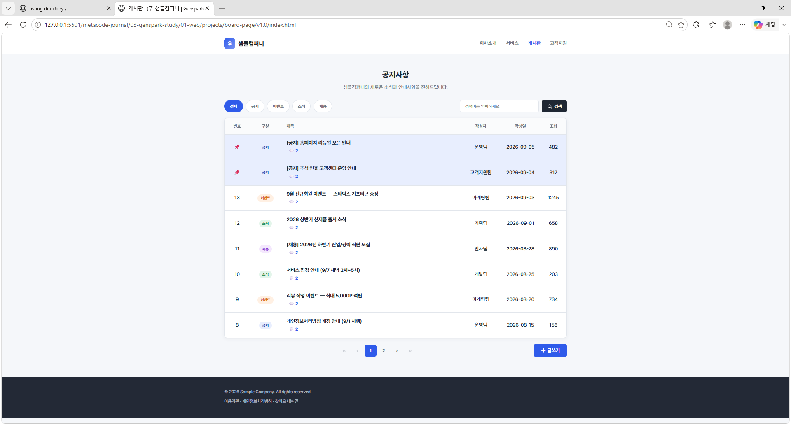

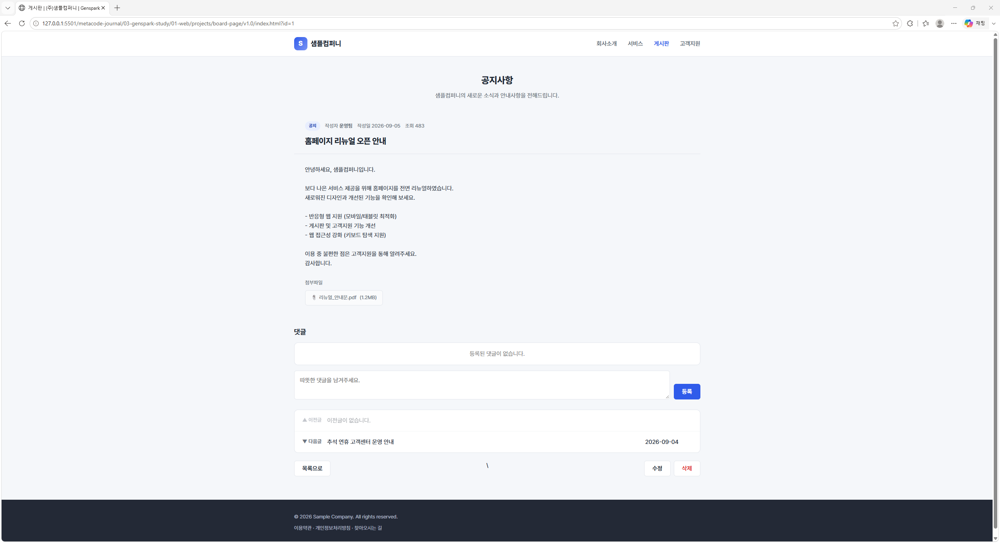


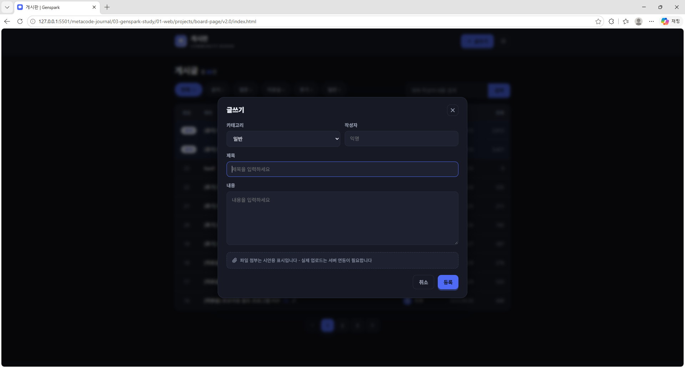

---

## v2.0 - 시안 이미지

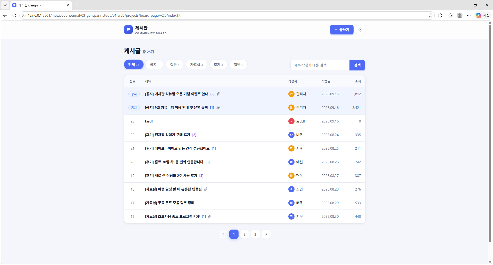

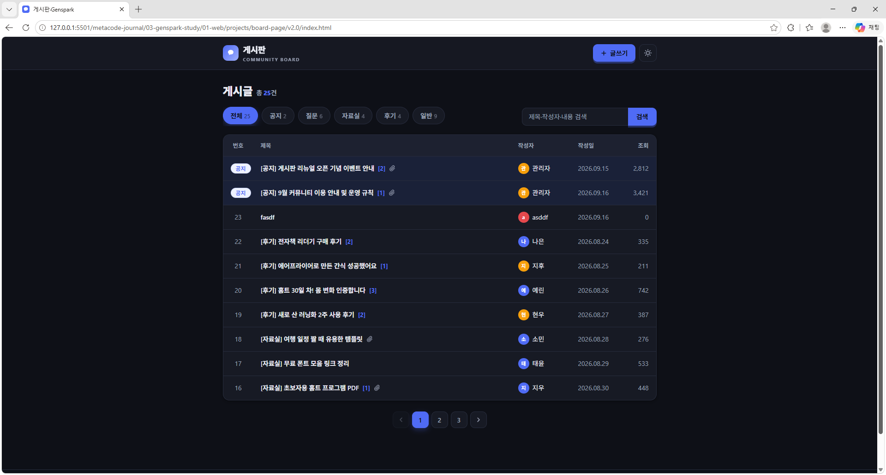

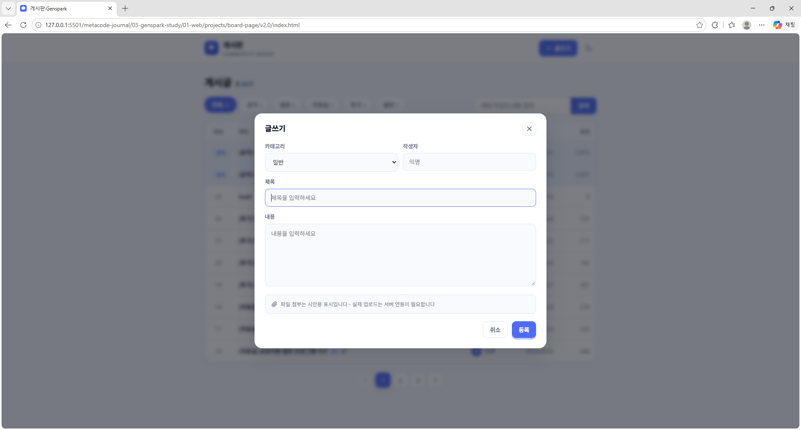

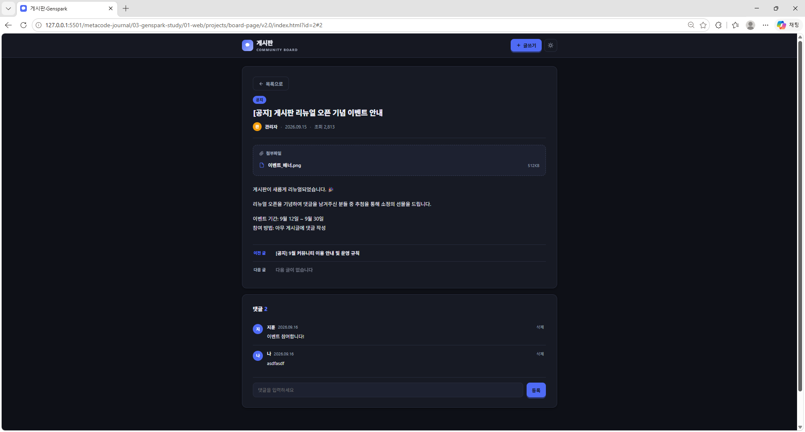

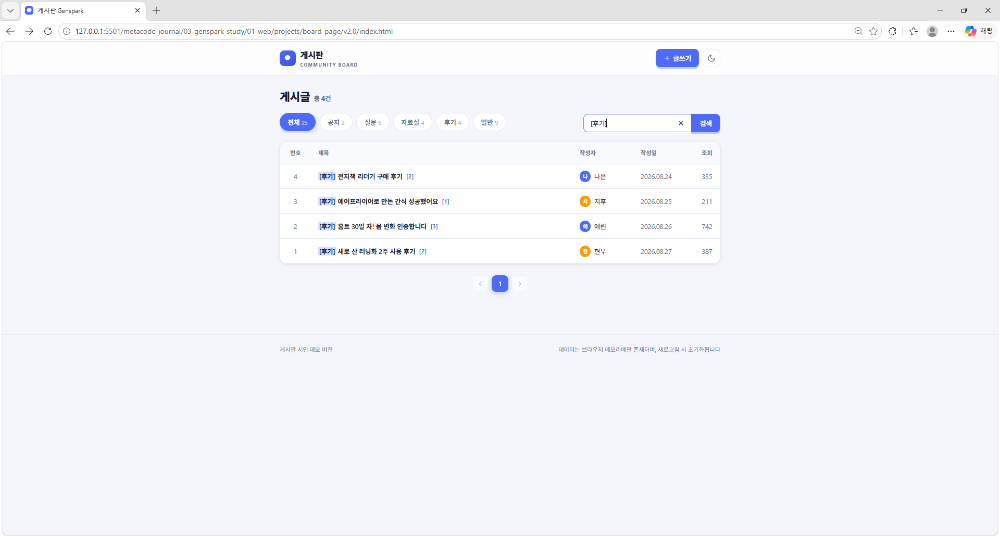

---

## v3.0 - 시안 이미지

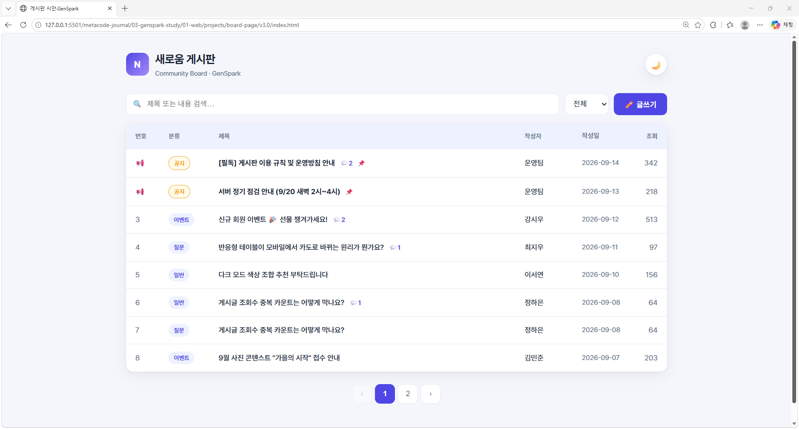

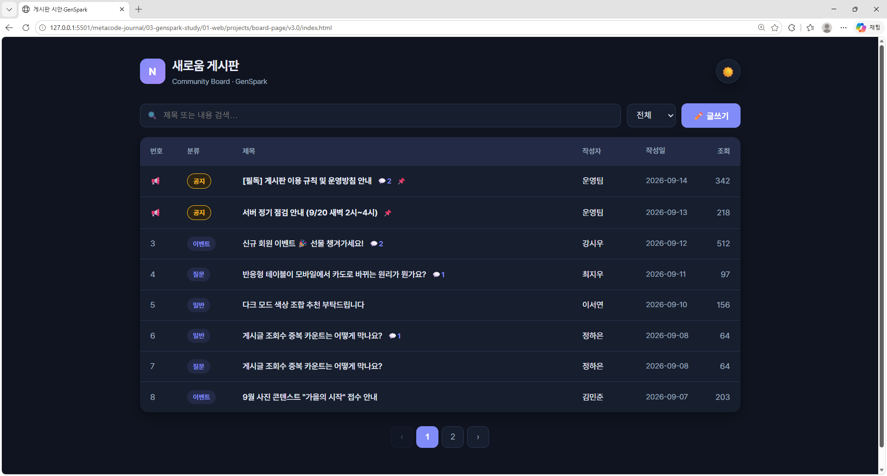

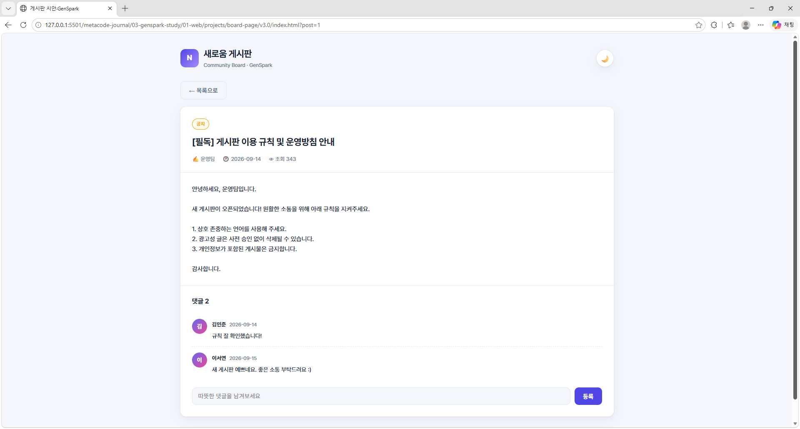

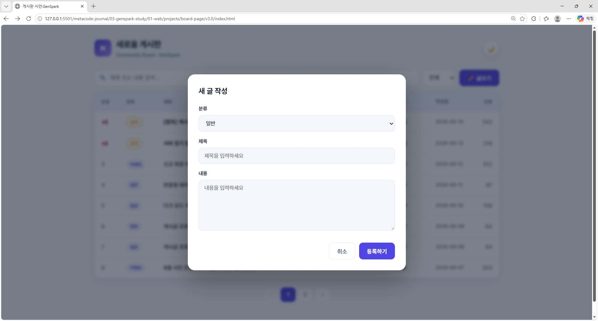

---

## 버전별 비교

| 구분 | v1.0 | v2.0 | v3.0 |
|------|------|------|------|
| 컨셉 | 회사 공지사항 게시판 | 커뮤니티 게시판 | 개발 커뮤니티 게시판 |
| 목록 형태 | 테이블 + 페이지네이션 | 카테고리 탭 + 목록 | 테이블(모바일 카드형) |
| 화면 전환 | `?page=` / `?id=` (pushState) | 목록 ↔ 상세 뷰 전환 | `?post=` (pushState) |
| 글쓰기 | 별도 작성 화면 (수정 · 삭제 포함) | 작성 모달 | 작성 모달 |
| 데이터 저장 | JS 더미 배열 | localStorage 저장 | JS 더미 배열 |
| 추가 요소 | 공지 고정, 첨부파일, 이전/다음 글 | 다크 모드, 첨부파일 목록 | 공지 배지, 카테고리 필터 |

---

## 주요 기능

### v1.0

| 기능 | 설명 |
|------|------|
| 게시글 목록 | 한 페이지 8개, 페이지 번호 5개 단위 블록 이동 |
| 검색 · 정렬 | 제목 · 작성자 · 내용 검색, 공지는 상단 고정 후 최신순 정렬 |
| 상세 보기 | 본문 · 첨부파일 · 이전/다음 글 이동 |
| 댓글 | 댓글 목록 렌더링 및 등록 |
| 글쓰기 · 수정 · 삭제 | 분류 · 공지 여부 · 제목 · 작성자 · 내용 · 첨부 입력 |
| 주소 연동 | `history.pushState`로 `?page=` · `?id=` 기록, 뒤로 가기(`popstate`) 지원 |
| NEW 배지 · 토스트 | 최근 글 표시, 동작 결과 알림 |

### v2.0

| 기능 | 설명 |
|------|------|
| 카테고리 탭 | 공지 / 일반 등 탭으로 목록 필터링 |
| 검색 | 제목 · 작성자 · 내용 검색, `search` 이벤트로 검색어 지우기까지 처리 |
| 상세 보기 | 첨부파일 목록, 이전/다음 글 내비게이션 |
| 댓글 | 아바타 색상 자동 생성 + 댓글 등록 |
| 작성 모달 | Esc 키로 닫기, 작성 후 목록 갱신 |
| 데이터 저장 | `localStorage('board-posts')`에 게시글 저장 |
| 다크 모드 | `localStorage('board-theme')`에 테마 저장 |
| 자동 검증 | `test_board.py` (Playwright) 로 화면 동작 확인 |

### v3.0

| 기능 | 설명 |
|------|------|
| 공지 고정 | `isNotice` 글은 공지 배지와 함께 목록 상단에 고정 |
| 검색 + 카테고리 필터 | 제목 · 본문 검색, 입력(`input`) · 선택(`change`) 즉시 목록 갱신 |
| 페이지네이션 | 한 페이지 8개 |
| 상세 보기 | `?post=` 주소로 상세 화면, 뒤로 가기 시 목록 복귀 |
| 댓글 · 글쓰기 모달 | 댓글 등록, 모달로 새 글 작성 |
| XSS 방지 | `escapeHtml()`로 사용자 입력 출력 |

---

## 기본 파일 구조

```
board-page/
├── README.md
├── img/                  ← 시안 캡처 (preview-1.0 ~ preview-3.3)
├── v1.0/
│   ├── index.html        ← 목록 · 상세 · 작성 화면
│   ├── style.css
│   └── main.js           ← 더미 데이터 · 렌더링 · CRUD · 페이지네이션
├── v2.0/
│   ├── index.html
│   ├── style.css         ← 라이트 / 다크 테마
│   ├── main.js           ← localStorage 저장 · 탭 · 모달
│   └── test_board.py     ← Playwright 동작 검증 스크립트
└── v3.0/
    ├── index.html
    ├── style.css
    └── script.js
```

---

## 기술 스택

- **HTML5**: 시맨틱 태그, 폼 요소, `data-*` 속성
- **CSS3**: CSS 변수, Flexbox · Grid, 미디어 쿼리(모바일 카드형 테이블)
- **JavaScript (ES6+)**: 배열 `filter` · `sort` · `slice`, 템플릿 문자열 렌더링, History API, localStorage
- **Python**: Playwright 기반 화면 자동 검증 (v2.0)

---

## 실행 방법

각 버전 폴더의 `index.html`을 VS Code **Live Server** 등 로컬 서버로 열어 확인합니다.

```
board-page/v1.0/index.html
board-page/v2.0/index.html
board-page/v3.0/index.html
```

> v1.0 · v3.0은 주소창에 `?id=` · `?post=`가 붙으므로, `file://`보다 로컬 서버로 여는 것을 권장합니다.

---

## 학습 기록

> 개발 과정 5 ~ 7단계(코드 비교 → 버전 기록 → README 정리)를 직접 채우는 공간입니다.

| 버전 | 분석 · 수정한 내용 | 배운 점 |
|------|------|------|
| v1.0 | | |
| v2.0 | | |
| v3.0 | | |

### 트러블슈팅

| 증상 | 원인 | 해결 | 다음에 먼저 확인할 것 |
|------|------|------|------|
| | | | |

---

## 다음 단계

- [ ] v1.1: v1.0 게시글 데이터를 localStorage에 저장해 새로고침 후에도 유지
- [ ] v2.1: 게시글 수정 · 삭제 기능 추가
- [ ] v3.1: 정렬(최신순 / 조회순) 추가

---

## 저작권

© 2026 Gi So Jeong. All rights reserved.
학습 · 포트폴리오 목적으로 공개된 코드입니다. 자세한 내용은 [상위 README의 저작권 안내](../../README.md#저작권-copyright)를 참고하세요.
