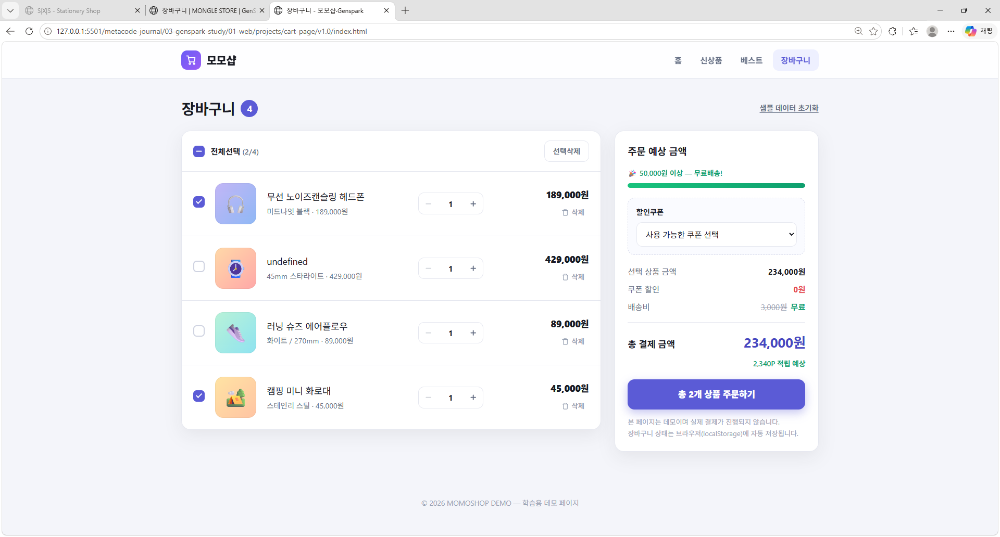
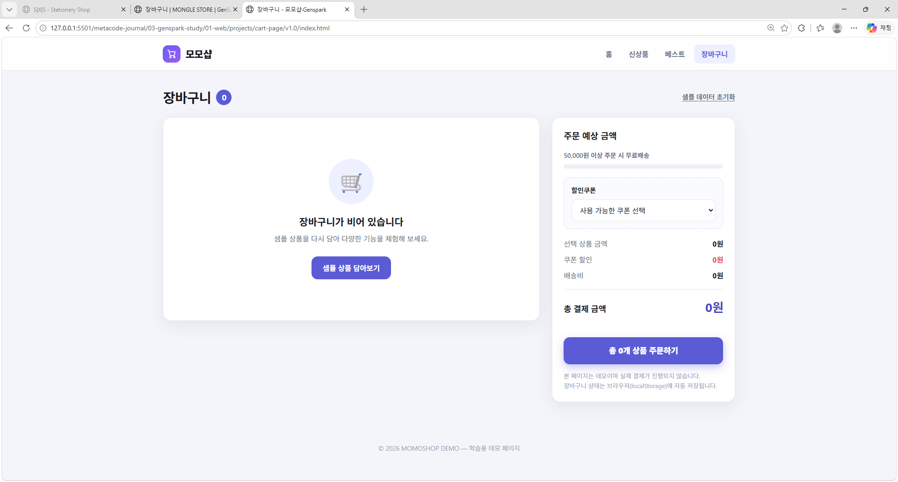
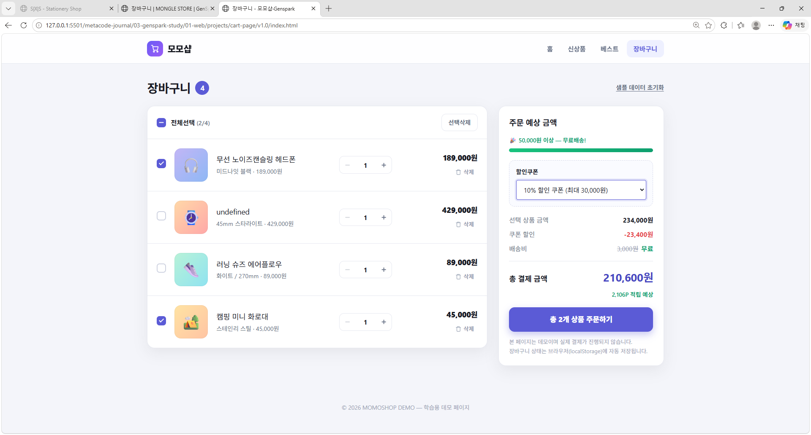
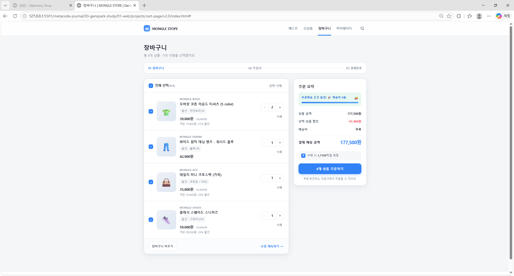
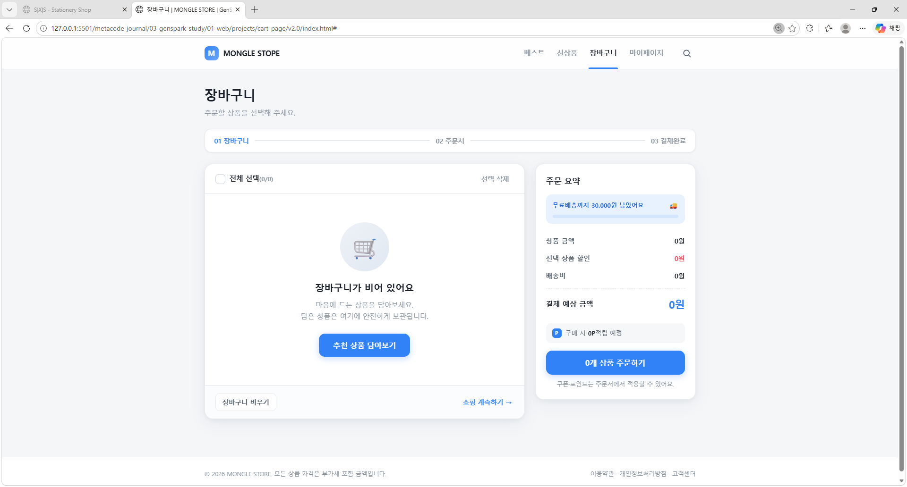
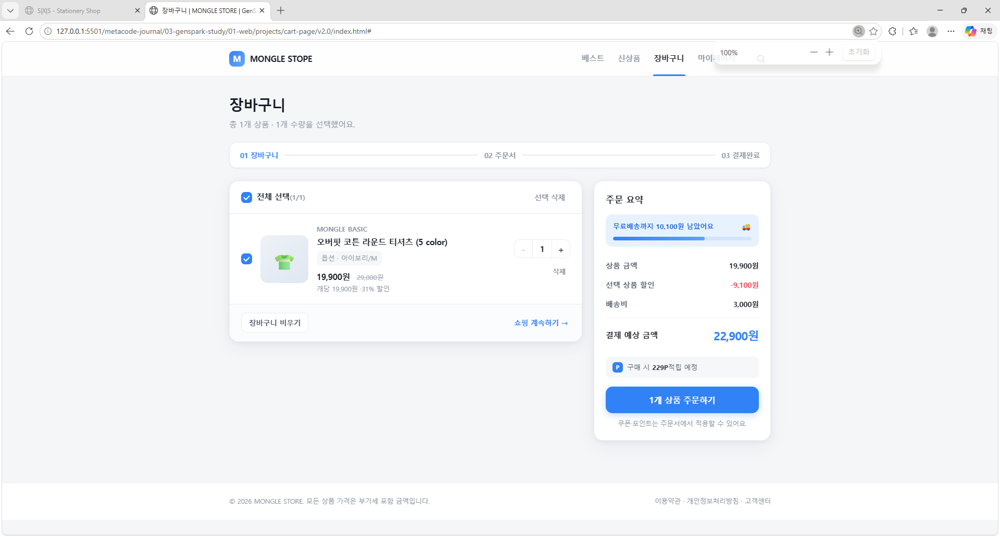
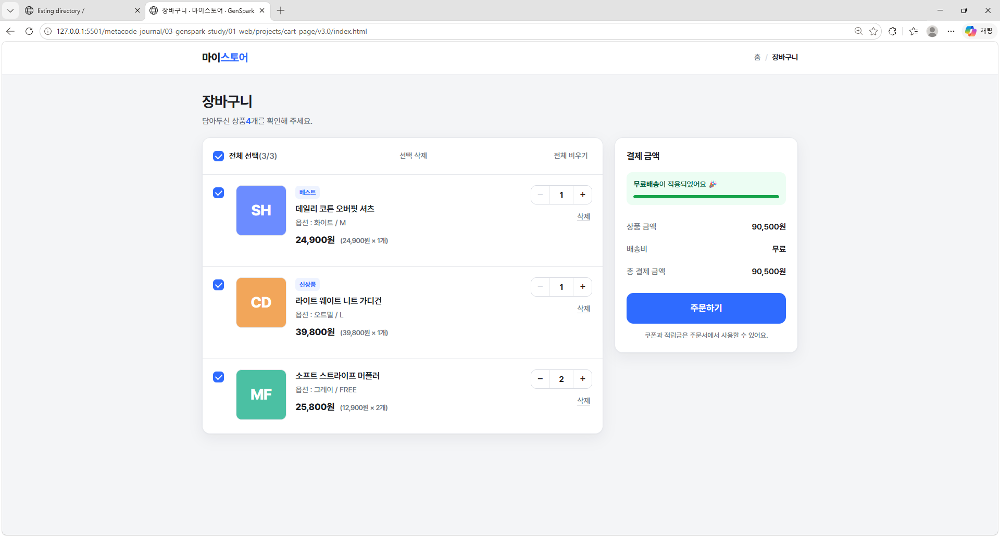
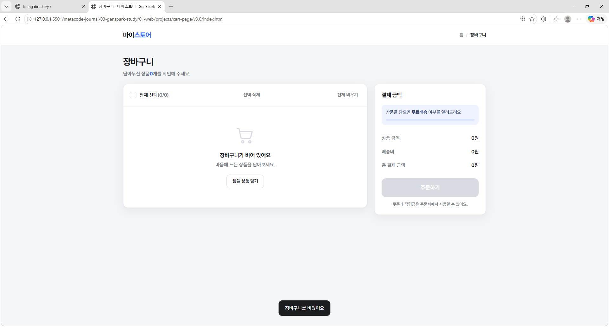
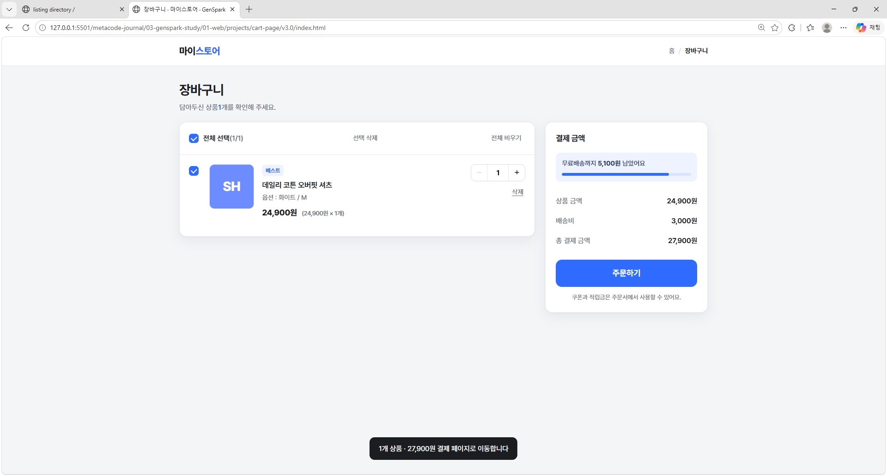

# 장바구니 페이지 시안 (v1.0 ~ v3.0 기반)

> 상위 문서: [Genspark 웹사이트 구현 및 개발 학습 프로젝트](../../README.md)

---

## 프로젝트 개요

이 프로젝트는 **젠스파크(Genspark)**를 통해 제공받은 웹 디자인 시안(v1.0 ~ v3.0)을 실습용으로 구현한 미니 프로젝트입니다. 본 문서는 **v1.0 ~ v3.0 시안 기반 장바구니 페이지**의 README이며, 모든 버전이 **HTML · CSS · JavaScript**로 제작되었습니다.

장바구니는 수량 · 선택 여부 · 할인 · 배송비가 서로 영향을 주는 페이지라서 **상태 관리와 계산 로직**을 연습하기에 좋습니다.

---

## 프로젝트(v1.0 ~ v3.0)의 목적

- 상품 배열(**상태**)을 바꾸고 → 화면을 다시 그리는(**렌더링**) 흐름 익히기
- 수량 변경 · 선택 · 삭제 등 **이벤트 위임**으로 여러 버튼을 한 번에 처리하기
- 전체 선택 체크박스와 개별 체크박스 **동기화**(`indeterminate` 포함)
- 무료배송 기준 · 쿠폰 · 적립금 등 **금액 계산 로직** 분리하기

---

## v1.0 - 시안 이미지







---

## v2.0 - 시안 이미지







---

## v3.0 - 시안 이미지







---

## 버전별 비교

| 구분 | v1.0 (모모샵) | v2.0 (MONGLE STORE) | v3.0 (마이스토어) |
|------|------|------|------|
| 할인 방식 | 쿠폰 선택 (10% · 5,000원) | 상품별 정가 · 할인율 표시 | 할인 없음 (기본 계산) |
| 배송비 | 3만 원 이상 무료 + 진행 바 | 3만 원 이상 무료 + 진행 바 | 3만 원 이상 무료 + 진행 바 |
| 적립금 | 표시 | 결제 금액의 1% | - |
| 상태 저장 | localStorage | 저장 없음 | 저장 없음 |
| 모바일 | 하단 고정 결제 바 | 화면 크기에 따라 결제 바 생성 | 반응형 레이아웃 |
| 썸네일 | 그라디언트 + 이모지 | 그라디언트 + 이모지 | 단색 배경 + 텍스트 라벨 |

---

## 주요 기능

### 공통

- **수량 조절**: `+` / `-` 버튼, 최대 99개 제한 (한계값에서 버튼 비활성화)
- **체크박스 동기화**: 전체 선택 ↔ 개별 선택 (v1.0 · v3.0은 일부 선택 시 `indeterminate` 상태)
- **실시간 결제 금액**: 선택한 상품만 합산, 무료배송까지 남은 금액 안내
- **선택 삭제 · 빈 장바구니**: 비었을 때 안내 화면 + 샘플 상품 복원
- **토스트 알림**: 삭제 · 복원 · 주문 이동 시 피드백

### v1.0

| 기능 | 설명 |
|------|------|
| 수량 직접 입력 | `<input type="number">`로 1 ~ 99 사이 값 입력 |
| 쿠폰 적용 | 10% 할인(최대 30,000원) / 5만 원 이상 5,000원 할인 |
| 상태 저장 | `localStorage`에 장바구니 저장, 새로고침 후에도 유지 |
| 초기화 | 헤더의 초기화 버튼으로 샘플 상품 복원 |
| 모바일 결제 바 | 작은 화면에서 하단에 합계 · 주문 버튼 고정 |

### v2.0

| 기능 | 설명 |
|------|------|
| 할인가 계산 | 할인 상품은 정가 대비 할인가로 단가 계산 |
| 적립 포인트 | 결제 금액의 1%를 포인트로 표시 |
| 선택 삭제 · 전체 비우기 | 버튼별로 다른 삭제 범위 처리 |
| 반응형 결제 바 | `resize` 이벤트로 화면 크기에 맞춰 하단 결제 바 표시 |

### v3.0

| 기능 | 설명 |
|------|------|
| 상태 → 렌더링 구조 | `items` 배열을 기준으로 `render()` 한 번에 화면 갱신 |
| 주문하기 | 선택 상품 수와 합계를 토스트로 안내, 선택이 없으면 경고 |
| XSS 방지 | `escapeHtml()`로 상품명 출력 |

---

## 기본 파일 구조

```
cart-page/
├── README.md
├── img/                  ← 시안 캡처 (preview-1.0 ~ preview-3.2)
├── v1.0/
│   ├── index.html
│   ├── style.css
│   └── script.js         ← 상태 저장 · 쿠폰 · 수량 · 체크박스 로직
├── v2.0/
│   ├── index.html
│   ├── style.css
│   └── script.js         ← 할인가 · 포인트 · 모바일 결제 바
└── v3.0/
    ├── index.html
    ├── style.css
    └── script.js         ← 상태 관리 + 렌더링
```

---

## 기술 스택

- **HTML5**: 시맨틱 태그, 체크박스 · 숫자 입력 폼, `data-*` 속성
- **CSS3**: Flexbox, Custom Properties(CSS 변수), 미디어 쿼리, 진행 바 애니메이션
- **JavaScript (ES6+)**: 이벤트 위임(Event Delegation), 배열 고차 함수(`filter` · `reduce`), localStorage

---

## 실행 방법

각 버전 폴더의 `index.html`을 VS Code **Live Server** 등 로컬 서버로 열어 확인합니다.

```
cart-page/v1.0/index.html
cart-page/v2.0/index.html
cart-page/v3.0/index.html
```

> v1.0은 localStorage에 저장되므로, 처음 상태로 보고 싶으면 개발자 도구 → Application → Local Storage에서 값을 지우거나 초기화 버튼을 누르세요.

---

## 학습 기록

> 개발 과정 5 ~ 7단계(코드 비교 → 버전 기록 → README 정리)를 직접 채우는 공간입니다.

| 버전 | 분석 · 수정한 내용 | 배운 점 |
|------|------|------|
| v1.0 | | |
| v2.0 | | |
| v3.0 | | |

### 트러블슈팅

| 증상 | 원인 | 해결 | 다음에 먼저 확인할 것 |
|------|------|------|------|
| | | | |

---

## 다음 단계

- [ ] v1.1: 쿠폰 종류 추가 및 쿠폰 적용 조건 안내 문구 표시
- [ ] v2.1: v2.0에 localStorage 저장 기능 추가
- [ ] v3.1: 할인 · 적립금 계산 추가

---

## 저작권

© 2026 Gi So Jeong. All rights reserved.
학습 · 포트폴리오 목적으로 공개된 코드입니다. 자세한 내용은 [상위 README의 저작권 안내](../../README.md#저작권-copyright)를 참고하세요.
