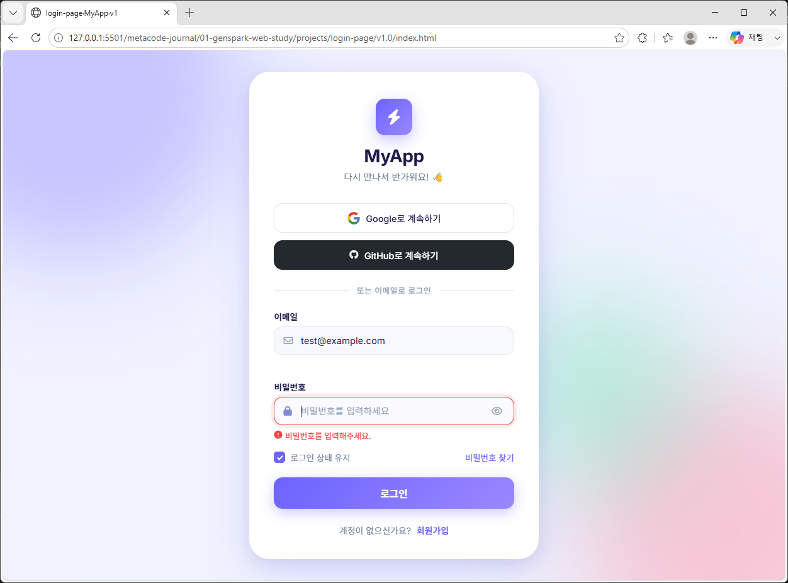
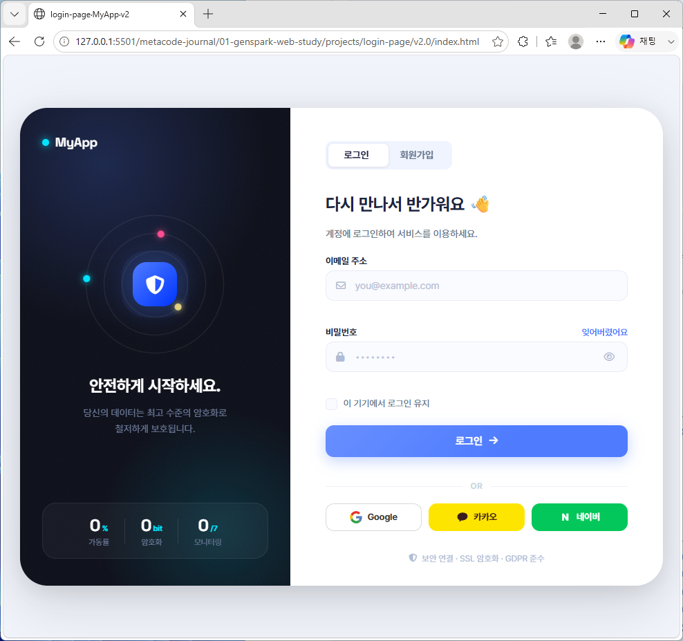
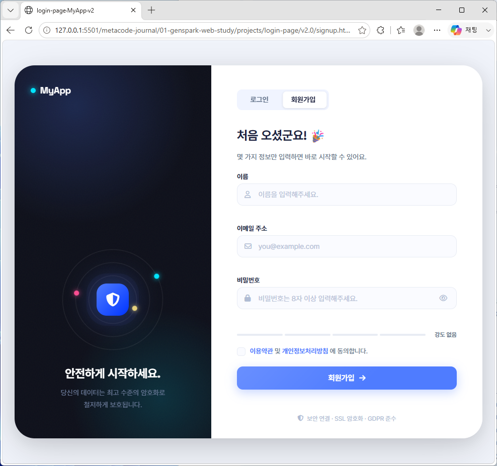
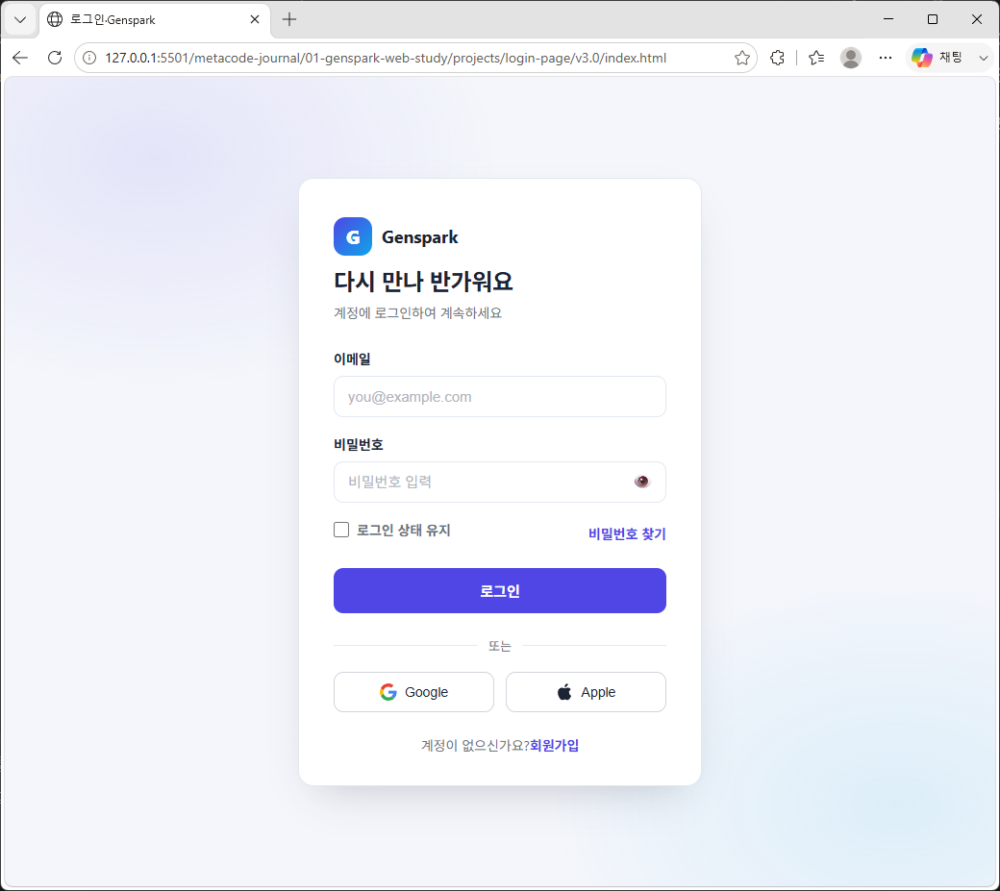
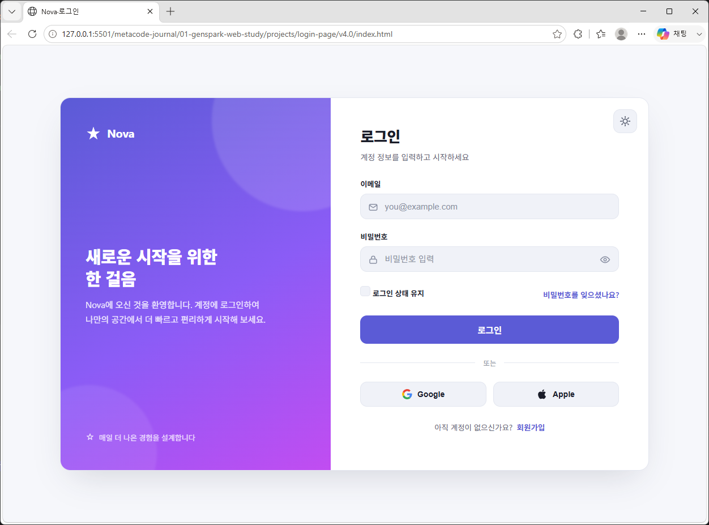

# 로그인 페이지 시안 (v1.0 ~ v3.0 기반)

> 상위 문서: [Genspark 웹사이트 구현 및 개발 학습 프로젝트](../../README.md)

---

## 프로젝트 개요

이 프로젝트는 **젠스파크(Genspark)**를 통해 제공받은 웹 디자인 시안(v1.0 ~ v3.0)을 실습용으로 구현한 미니 프로젝트입니다. 본 문서는 **v1.0 ~ v3.0 시안 기반 로그인 페이지**의 README이며, 모든 버전이 **HTML · CSS · JavaScript**로 제작되었습니다.

로그인은 입력 → 검사 → 피드백으로 이어지는 가장 기본적인 폼 페이지라서 **폼 이벤트와 유효성 검사**를 연습하기에 좋습니다.

---

## 프로젝트(v1.0 ~ v3.0)의 목적

- `input` · `blur` · `submit` 이벤트로 **실시간 유효성 검사** 구현하기
- 성공 / 실패 / 로딩 상태를 **CSS 클래스 전환**으로 표현하기
- `localStorage`로 **로그인 상태 유지(이메일 기억)** 기능 만들기
- 반응형, 접근성(`aria-*`), 인터랙션 등 프론트엔드 기본기 강화

---

## v1.0 - 시안 이미지



---

## v2.0 - 시안 이미지





---

## v3.0 - 시안 이미지



---

## v4.0 - 시안 이미지 (코드 구현 예정)



---

## 데모 계정 (테스트용)

| 이메일 | 비밀번호 |
|--------|----------|
| `demo@myapp.com` | `demo1234` |
| `test@example.com` | `test5678` |

> 실제 서버 인증이 아니라 JS 배열에 들어 있는 **가짜 계정**입니다. 실제 서비스에서는 서버 API로 대체해야 합니다.

---

## 버전별 비교

| 구분 | v1.0 | v2.0 | v3.0 |
|------|------|------|------|
| 레이아웃 | 가운데 카드 + 배경 블롭 | 왼쪽 브랜드 패널 + 오른쪽 폼 | 단일 카드 (가벼운 구성) |
| 탭 | 없음 | 로그인 / 회원가입 탭 전환 | 없음 |
| 소셜 로그인 | Google · GitHub | - | Google · Apple |
| 로그인 유지 | localStorage 이메일 저장 | localStorage 이메일 저장 | 체크 여부만 토스트로 안내 |
| 추가 페이지 | - | `signup.html`, `showcase.html` | - |
| JS 구조 | 함수 단위 | 함수 단위 + 회원가입 스크립트 분리 | IIFE로 감싼 단일 블록 |

---

## 주요 기능

### v1.0

| 기능 | 설명 |
|------|------|
| 이메일 / 비밀번호 로그인 폼 | 입력 이벤트 기반 실시간 유효성 검사 (blur & submit) |
| 비밀번호 표시/숨기기 | 눈 아이콘 토글 버튼으로 input type 전환 |
| 로그인 상태 유지 | localStorage를 통한 이메일 저장 및 자동 복원 |
| 소셜 로그인 버튼 | Google / GitHub UI 제공, 토스트 안내 메시지 표시 |
| 로딩 스피너 | 제출 중 버튼 로딩 상태 및 비활성화 처리 |
| 토스트 메시지 | 성공 / 실패 / 안내 세 가지 타입의 피드백 제공 |
| 카드 흔들기 애니메이션 | 로그인 실패 시 shake 효과로 시각적 피드백 |
| 반응형 레이아웃 | 모바일(480px↓) 최적화 및 유연한 레이아웃 구성 |
| 접근성 | aria-label, aria-live, role="alert" 등 접근성 속성 적용 |
| 배경 블롭 애니메이션 | 부드러운 float 효과의 컬러 블롭 배경 구현 |

### v2.0

| 기능 | 설명 |
|------|------|
| 로그인 / 회원가입 탭 | `role="tablist"` 탭 버튼과 인디케이터 이동 |
| 통계 카운트업 | 브랜드 패널의 숫자가 `data-target` 값까지 올라가는 애니메이션 |
| 비밀번호 강도 검사 | 회원가입 입력 시 강도 단계 표시 |
| 로그인 유지 | 체크 시 이메일을 localStorage에 저장 |
| 시안 선택 페이지 | `showcase.html`에서 버전별 시안으로 이동 |
| 회원가입 페이지 | `signup.html` + `signup-main.js`로 분리 구현 |

### v3.0

| 기능 | 설명 |
|------|------|
| 필드별 에러 표시 | `showError()` / `clearError()`로 입력칸 아래 메시지 표시 · 제거 |
| 비밀번호 토글 | `#togglePw` 버튼으로 표시 / 숨기기 |
| 소셜 로그인 버튼 | Google · Apple 버튼 클릭 시 토스트 안내 |
| 토스트 메시지 | 로그인 성공 및 상태 유지 여부 안내 |

---

## 기본 파일 구조

```
login-page/
├── README.md
├── img/                  ← 시안 캡처 (preview-1.1 ~ preview-4.0)
├── v1.0/
│   ├── index.html        ← 메인 페이지
│   ├── style.css         ← 모든 스타일 (CSS 변수, 애니메이션 포함)
│   └── main.js           ← 인터랙션 & 유효성 검사 로직
├── v2.0/
│   ├── index.html        ← 로그인 페이지
│   ├── signup.html       ← 회원가입 페이지
│   ├── showcase.html     ← 시안 선택 페이지
│   ├── style.css
│   ├── main.js           ← 로그인 · 탭 · 통계 애니메이션
│   └── signup-main.js    ← 회원가입 유효성 검사
└── v3.0/
    ├── index.html
    ├── style.css
    └── main.js
```

---

## 기술 스택

- **HTML5**: 폼 요소, `role` · `aria-*` 접근성 속성
- **CSS3**: CSS 변수, keyframes 애니메이션(shake · float · spinner), 미디어 쿼리
- **JavaScript (ES6+)**: 정규식 기반 이메일 검사, `async/await` + `delay()`로 로딩 흉내, localStorage

---

## 실행 방법

각 버전 폴더의 `index.html`을 VS Code **Live Server** 등 로컬 서버로 열어 확인합니다.

```
login-page/v1.0/index.html
login-page/v2.0/index.html      (시안 선택: v2.0/showcase.html)
login-page/v3.0/index.html
```

> 위 **데모 계정**으로 로그인하면 성공 흐름을, 다른 값을 넣으면 실패 흐름(흔들기 · 에러 메시지)을 확인할 수 있습니다.

---

## 학습 기록

> 개발 과정 5 ~ 7단계(코드 비교 → 버전 기록 → README 정리)를 직접 채우는 공간입니다.

| 버전 | 분석 · 수정한 내용 | 배운 점 |
|------|------|------|
| v1.0 | | |
| v2.0 | | |
| v3.0 | | |

### 트러블슈팅

| 증상 | 원인 | 해결 | 다음에 먼저 확인할 것 |
|------|------|------|------|
| | | | |

---

## 다음 단계

- [ ] v1.1: 비밀번호 찾기 화면 추가
- [ ] v3.1: v3.0에 localStorage 로그인 유지 기능 추가
- [ ] v4.0: 시안 이미지(`preview-4.0.png`) 기반 코드 구현

---

## 저작권

© 2026 Gi So Jeong. All rights reserved.
학습 · 포트폴리오 목적으로 공개된 코드입니다. 자세한 내용은 [상위 README의 저작권 안내](../../README.md#저작권-copyright)를 참고하세요.
