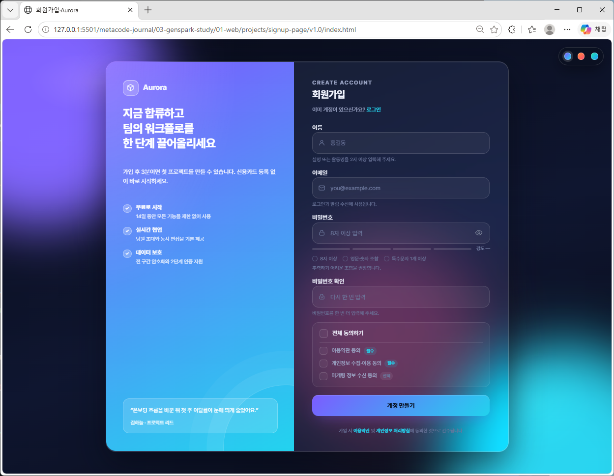
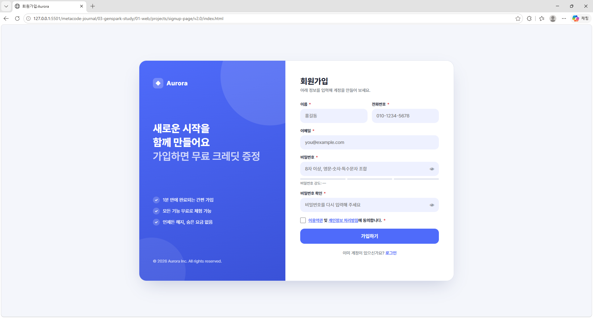
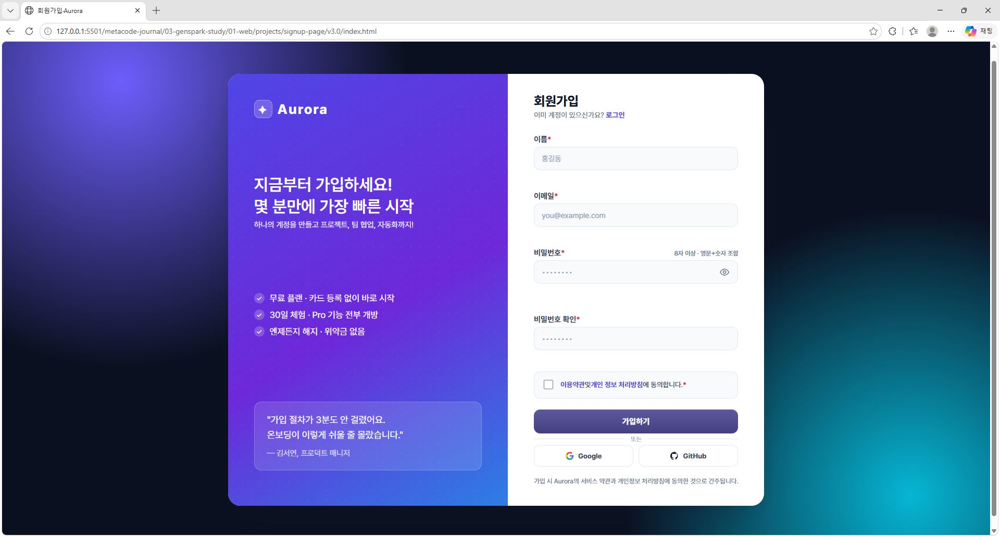
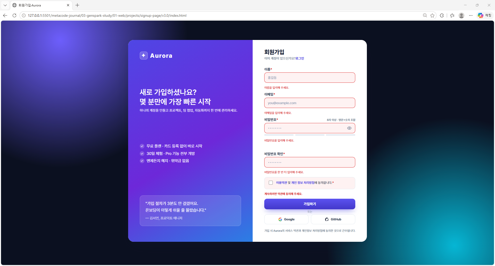

# 회원가입 페이지 시안 (v1.0 ~ v3.0 기반)

> 상위 문서: [Genspark 웹사이트 구현 및 개발 학습 프로젝트](../../README.md)

---

## 프로젝트 개요

이 프로젝트는 **젠스파크(Genspark)**를 통해 제공받은 웹 디자인 시안(v1.0 ~ v3.0)을 실습용으로 구현한 미니 프로젝트입니다. 본 문서는 **v1.0 ~ v3.0 시안 기반 회원가입 페이지(Aurora)**의 README이며, 모든 버전이 **HTML · CSS · JavaScript**로 제작되었습니다.

회원가입은 입력칸이 많고 칸끼리 서로 영향을 주기 때문에(비밀번호 ↔ 비밀번호 확인, 약관 전체 동의 ↔ 개별 동의) **여러 필드의 검사 규칙을 정리하는 연습**에 좋습니다.

---

## 프로젝트(v1.0 ~ v3.0)의 목적

- 필드별 **검사 규칙(정규식)**을 함수로 분리하고 재사용하기
- 비밀번호 **강도 점수 → 막대 · 문구** 로 시각화하기
- 약관 **전체 동의 ↔ 개별 동의** 체크박스 동기화하기
- 제출 데이터를 **서버로 보내는 구조**(`async` / `fetch`) 미리 만들어 보기

---

## v1.0 - 시안 이미지



---

## v2.0 - 시안 이미지



---

## v3.0 - 시안 이미지





---

## 버전별 비교

| 구분 | v1.0 | v2.0 | v3.0 |
|------|------|------|------|
| 입력 필드 | 이름 · 이메일 · 비밀번호 · 확인 · 약관 | + **휴대폰 번호** | 이름 · 이메일 · 비밀번호 · 확인 · 약관 |
| 비밀번호 표시 | 4단계 강도 바 + 규칙 체크리스트 | 강도 단계 문구 | 강도 미터 + 문구 |
| 가입 완료 | 성공 화면으로 전환 + 다시 하기 | 성공 배너 표시 | 토스트 메시지 |
| 테마 | 라이트 / 다크 (localStorage 저장) | - | - |
| 서버 전송 | - | - | `submitToServer()` 데모 (fetch 자리 준비) |
| JS 구조 | IIFE + 검사 함수 분리 | IIFE + 필드 → 검사 함수 맵 | 화살표 함수 + `async` 제출 |

---

## 주요 기능

### v1.0

| 필드 | 검증 규칙 | 상태 표시 |
|------|------|------|
| 이름 | 2~30자 | 빈값 시 기본 안내, blur 후 검증, 통과 시 ✓ |
| 이메일 | 정규식 `/^[^\s@]+@[^\s@.]+(?:\.[^\s@.]+)+$/` | 통과 시 ✓, 형식 오류 시 ✗ + 안내문 |
| 비밀번호 | 8자 이상 + 영문 + 숫자 + 특수문자 1개 | 4단계 강도 바 + 규칙 체크리스트가 실시간으로 채워짐 |
| 비밀번호 확인 | 원본과 일치 | 비밀번호를 바꾸면 확인 칸도 즉시 다시 검증 |
| 약관 동의 | 필수 2개 + 선택 1개 | 전체 동의 `indeterminate` 상태, 미동의 시 빨간 테두리 |

### v2.0

| 기능 | 설명 |
|------|------|
| 이름 검사 | 한글 2 ~ 5자 (`/^[가-힣]{2,5}$/`) |
| 휴대폰 번호 검사 | `010-1234-5678` 형식, 하이픈 생략 가능 |
| 비밀번호 검사 | 8자 이상 + 영문 + 숫자 조합, 강도 단계 표시 |
| 전체 검사 | 제출 시 `validateAll()`로 모든 필드 한 번에 확인, 실패 시 흔들기 |
| 성공 배너 | 가입 성공 시 배너 표시 후 부드럽게 스크롤 |

### v3.0

| 기능 | 설명 |
|------|------|
| 필드 검사 | 이름 · 이메일 · 비밀번호 · 확인 · 약관을 각각의 `validate*()` 함수로 검사 |
| 비밀번호 강도 미터 | 길이(8자 · 12자) · 문자 조합으로 점수 계산 |
| 서버 전송 구조 | `submitToServer()`에서 0.9초 대기 후 성공 응답 (실제 `fetch` 코드는 주석으로 준비) |
| 데모 링크 안내 | 로그인 · 이용약관 · 개인정보 링크 클릭 시 토스트 안내 |

---

## 기본 파일 구조

```
signup-page/
├── README.md
├── img/                  ← 시안 캡처 (preview-1.0 ~ preview-3.2)
├── v1.0/
│   ├── index.html        ← 가입 폼 + 성공 화면
│   ├── style.css         ← 라이트 / 다크 테마, 애니메이션
│   └── main.js           ← 검사 규칙 · 강도 계산 · 약관 동기화
├── v2.0/
│   ├── index.html
│   ├── style.css
│   └── main.js           ← 휴대폰 번호 검사 추가
└── v3.0/
    ├── index.html
    ├── style.css
    └── script.js         ← 서버 전송 구조(async)
```

---

## 기술 스택

- **HTML5**: 폼 요소, `aria-invalid` · `aria-describedby` 등 접근성 속성
- **CSS3**: CSS 변수, 상태 클래스(성공 / 오류), keyframes 애니메이션
- **JavaScript (ES6+)**: 정규식 검사, IIFE, `async/await`, localStorage

---

## 실행 방법

각 버전 폴더의 `index.html`을 VS Code **Live Server** 등 로컬 서버로 열어 확인합니다.

```
signup-page/v1.0/index.html
signup-page/v2.0/index.html
signup-page/v3.0/index.html
```

> v3.0에서 가입 버튼을 누른 뒤 개발자 도구 **Console** 탭을 열면 서버로 보낼 데이터(`[DEMO]` 로그)를 확인할 수 있습니다.

---

## 학습 기록

> 개발 과정 5 ~ 7단계(코드 비교 → 버전 기록 → README 정리)를 직접 채우는 공간입니다.

| 버전 | 분석 · 수정한 내용 | 배운 점 |
|------|------|------|
| v1.0 | | |
| v2.0 | | |
| v3.0 | | |

### 트러블슈팅

| 증상 | 원인 | 해결 | 다음에 먼저 확인할 것 |
|------|------|------|------|
| | | | |

---

## 다음 단계

- [ ] v1.1: 이메일 중복 확인 버튼(데모 데이터 기반) 추가
- [ ] v2.1: 휴대폰 번호 입력 시 하이픈 자동 삽입
- [ ] v3.1: `submitToServer()`를 실제 API(`fetch`)와 연결

---

## 저작권

© 2026 Gi So Jeong. All rights reserved.
학습 · 포트폴리오 목적으로 공개된 코드입니다. 자세한 내용은 [상위 README의 저작권 안내](../../README.md#저작권-copyright)를 참고하세요.
